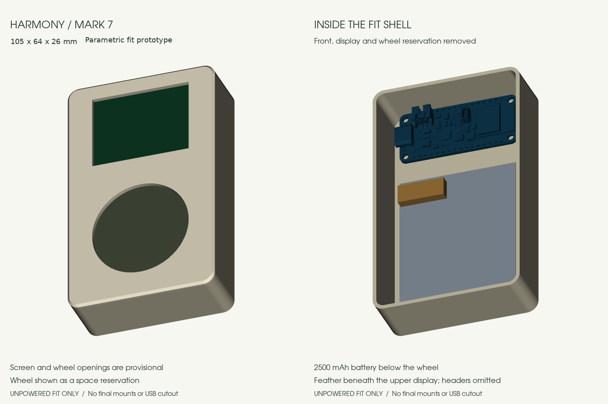

# Mark-7 pocket fit prototype

Design basis: October 3, 2026. Tracking: Build Mark-7 portable Bluetooth player (HARMONY-19).

Dave wants Harmony close to fourth-generation iPod size. He accepts a smaller screen, keeps the Adafruit #328 2500 mAh battery, and accepts added thickness. Dave confirmed the iPod capacitive wheel as the Mark-7 control. Dave reports both Adafruit and Elite Obsolete orders purchased on October 3; delivery is pending. This study supersedes the 74 × 178 × 28 mm portable revision A. It is not a fit-verified enclosure or a print release.

## Size and display

Apple lists the [20 GB fourth-generation iPod](https://support.apple.com/en-us/112541) at 4.1 × 2.4 × 0.57 inches, approximately 104 × 61 × 14.5 mm. The 40 GB version is 17.5 mm thick. Use this front footprint as the reference.

Select [Adafruit #4311](https://www.adafruit.com/product/4311), a 2-inch ST7789 display with an onboard microSD socket, listed at $19.95. Landscape orientation permits a shorter upper section. The vendor STEP under `reference/` measures 59.055 × 35.56 × 6.081 mm after rotation. Its rear components make the overall thickness greater than the product page's 3.7 mm figure. Allow approximately 64 mm case width with walls and clearance. The CAD shell has a 105 × 64 mm front. Dave printed the tray and front and approved the overall size on October 3. Component fit remains unverified.

The battery maximum envelope is 50.5 × 62.5 × 8.1 mm. A battery/display stack alone is about 14.2 mm before enclosure walls, insulation, restraint and wiring. The first parametric fit shell is 26 mm deep to reserve space for the Feather headers and wiring. Wheel bracket dimensions, connectors and antenna clearance could change it. Do not promise the original iPod's thickness.

The smaller display requires an ST7789 driver and a 320 × 240 interface layout. The current 320 × 480 screen configuration cannot be reused unchanged. Preserve the cream case and green interface. A separate [Mark-7 firmware target](../../../firmware/mark-7/pocket-player/README.md) now builds with this driver and a four-row compact UI. Host tests pass; physical orientation and color still require the arriving display.

## Adopted iPod wheel

Prefer a complete fourth-generation **iPod Photo / color A1099** wheel assembly with center button, flex and support bracket. [Elite Obsolete Electronics lists that complete assembly](https://eoe.works/products/original-click-wheel-center-button-flex-cable-for-apple-ipod-classic-4th-generation-photo-color) for $29.99 used. The live page shows Used selected and Add to Cart, and its photo includes the wheel, bracket and flex. The earlier $14.99 listing omits the external flex and support bracket. One complete Used assembly was prepared at $29.99. Dave subsequently reported the Elite Obsolete order purchased on October 3. Arrival is pending.

[Gigahawk's primary reverse-engineering record](https://github.com/Gigahawk/clickwheel_reverse_eng) tested the Photo wheel at 3.3 V. It documents touch positions, five buttons and a sleep command that retains button reports. BTN1 supplies a high pulse on center or Menu press, making it a candidate for ESP32 RTC wake. This requires an ESP32 driver and measurements under Bluetooth playback; compatibility and standby current are not established for Harmony. The ANO I2C interface and active-low wake circuit are not interchangeable with this wheel.

The [reference breakout schematic](https://github.com/Gigahawk/clickwheel_breakout_4th_gen/blob/master/clickwheel_breakout_4th_gen.kicad_sch) uses an SFV8R-2STE1HLF connector for the 8-pin interface. Amphenol identifies this as an 8-position, 0.50 mm pitch, top-contact connector. The selected adapter is recorded below; cable fit and pin mapping remain unverified. Later iPod generations have a different button arrangement and are not equivalent donors.

## Purchased parts

Dave reports both orders purchased on October 3. Adafruit: one #328 battery, one #2784 resistor pack and one #4311 display. Elite Obsolete: one complete Used Photo A1099 wheel, bracket and flex assembly. Prepared merchandise subtotals were $35.65 and $29.99; final tax, shipping, order numbers and delivery dates are not recorded. Existing wire permits soldered display connections. Retain the resistor pack for wheel-interface pull-ups, with values confirmed during bring-up.

Select the [Crystalfontz CFABB-CS050Z08G-A0 breakout](https://www.crystalfontz.com/product/cfabbcs050z08ga0-8-position-zif-breakout-board) as the bench adapter candidate. The manufacturer lists $6.08 and 34 units in stock on October 3. It includes the connector and breaks eight contacts out to 0.1-inch solder holes. Its [connector drawing](https://www.crystalfontz.com/products/document/4313/CS050ZxxG-A0mm.PDF) specifies 0.50 mm pitch, top and bottom contacts, and recommended 0.30 mm ribbon thickness. These match the documented reference connector requirements. No custom PCB is needed for the initial wheel test if the actual flex fits this connector.

Dave reports the Crystalfontz order purchased on October 3. It contains one wheel adapter ($6.08) and one CFAP640384A0-E2-1 7.5-inch e-paper display with adapter board ($99.18), which met the minimum order. The e-paper display is for a separate future project, not Harmony. Verified pre-purchase merchandise subtotal: $105.26; final shipping, tax and delivery date are not recorded. All currently selected Harmony parts are now ordered. Screenshot of the prepared cart: `/tmp/harmony-epaper-cart.png`.

Physical cable fit, orientation and pad-to-ribbon pin mapping remain to be verified before applying power; dual-sided contacts do not remove the possibility of reversing the pin order. Overall adapter-board dimensions remain unverified for the final pocket layout. The retained connector drawing is under `reference/`.

## Accepted size: 105 × 64 × 26 mm



Dave approved the printed size and requested softer edges. The current files add a 1 mm, 45-degree chamfer around the exterior front and back perimeters while retaining the 5 mm plan-view corner radius. Outer dimensions, mating faces, openings and component positions are unchanged. This bevel supports the existing flat-on-bed print orientation. The original printed files, parameters and generator are preserved in `archive/square-rim-fit/`; that archived generator is a source snapshot for restoration to this directory, not a standalone build.

`build.py` generates the tray, front and separate screen-opening coupon from `parameters.json`. The battery lies below the wheel; the Feather lies beneath the display. Use a second identical Feather and leave Mark-6 assembled. The vendor Feather model has no headers, so the collision checks reserve an assumed 7.4 mm extension below its PCB. The nominal Feather/display gap is 2.05 mm. This stacked layout still needs wiring and closed-case Bluetooth testing.

The wheel is a **48 mm diameter × 6 mm depth reservation**, with a provisional 42 mm front opening. Its actual bracket, button protrusion, flex and mounts are not modeled. The adapter's 20 × 8 × 4 mm reservation is also provisional. Screen registration must be checked against the actual panel. No USB opening, closure screws, board retention or protective battery cover is included yet. The shell is for unpowered hand fit and pocket-size evaluation; temporary tape can hold the empty halves together.

All 21 component/plastic intersection checks pass for the modeled reservations. The three print meshes are watertight single bodies and fit the A1 bed. This does not account for the real harness, adhesive, insulation or unmeasured parts. Dave printed the original square-rim tray and front. The updated chamfered files have not been sliced or printed; another immediate fit print is unnecessary unless he wants to compare edge feel.

| File | Purpose |
| --- | --- |
| [Tray 3MF](print/mark7-pocket-tray-FIT-ONLY.3mf) | 64 × 105 × 24 mm, open side up |
| [Front 3MF](print/mark7-pocket-front-FIT-ONLY.3mf) | 64 × 105 × 2 mm, flat on bed |
| [Screen coupon 3MF](print/mark7-pocket-screen-coupon-FIT-ONLY.3mf) | Small opening/alignment test |
| [STEP assembly](cad/assembly.step) | Editable CAD with vendor geometry and reservations |
| [Validation record](validation.json) | Bounds, intersections and source hashes |

Matching STL files are in `print/`. These 3MF files contain geometry, not a sliced Bambu project. For a size trial, import tray and front into Bambu Studio with the A1/0.4 mm nozzle profile; start with PLA, 0.20 mm layers and three walls. Review the sliced result before printing. No supports should be required for these open, flat parts.

To regenerate from the repository root:

```sh
uv run --with cadquery==2.8.0 --with trimesh --with matplotlib --with networkx --with lxml --with pillow python enclosure/mark-7/pocket-rev-b/build.py
uv run --with cadquery==2.8.0 --with trimesh --with matplotlib --with networkx --with lxml --with pillow python enclosure/mark-7/pocket-rev-b/render_preview.py
```

Run the firmware host tests first if regenerating the UI preview. After the parts arrive, measure the wheel bracket, adapter, header projection and screen opening alignment; then add mounts, wire routes, USB access, battery protection and screwed closure. Re-evaluate depth before the powered enclosure release.

## Current limits and references

Retain the working Mark-6 bench while the new display and wheel are brought up. Finish exact enclosure mounts after the donor assembly and connector geometry are known. Dave has printed and accepted the empty shell size on the Bambu A1. The chamfer update and final component retention remain physically untested.

- [Power and sleep requirements](../../../docs/mark-7-power-and-sleep.md)
- [Portable scope and earlier decision history](../../../docs/mark-7-portable-scope.md)
- [Display PCB source](https://github.com/adafruit/Adafruit-2.0-inch-240x320-TFT-PCB)
- [Display CAD source](https://github.com/adafruit/Adafruit_CAD_Parts/tree/main/4311%202in%20TFT%20IPS%20Display)
- [Earlier enclosure, superseded](../portable-rev-a/README.md)
