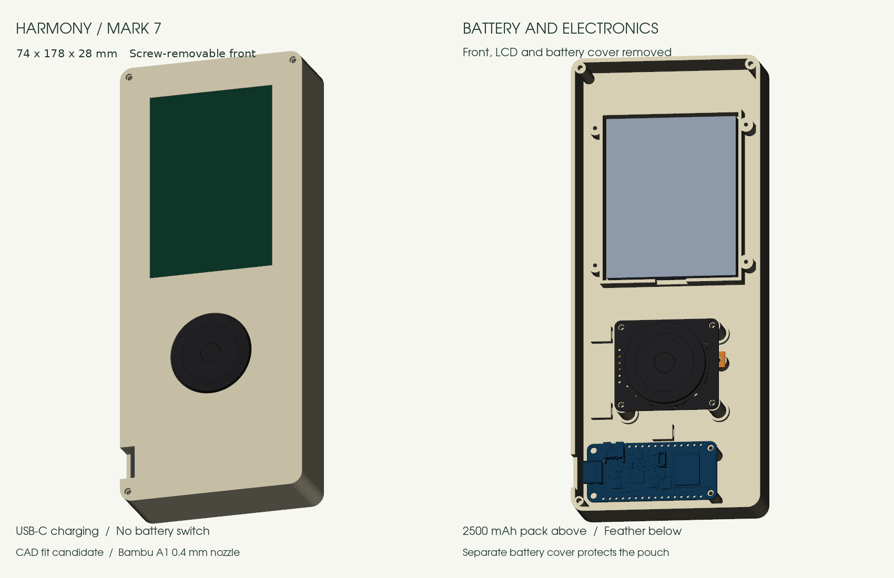

# Mark-7 portable enclosure, revision A

**Superseded October 3: do not print for the current build.** Dave rejected this size and requested a pocket version close to a fourth-generation iPod. See the [pocket design study](../pocket-rev-b/README.md). The files below are retained as an earlier fit candidate.

This earlier revision supplies a new tray and internal mounts for the Bambu A1. This revision holds the Adafruit #328 battery and hand-wired electronics without a custom carrier. It reuses the accepted Mark-6 revision-B front, wheel opening and display retainers. The case body remains 74 × 178 × 28 mm to preserve room for existing Feather headers and wiring.

Design date: October 3, 2026. Tracking: Build Mark-7 portable Bluetooth player (HARMONY-19). Dave authorized the new enclosure and proceeding before the battery arrives. This is a printable fit candidate; the new internal mounts have not been assembled or powered.

## Print files

- **Start here:** [tray and mounts](slicing/tray-and-mounts/harmony-m7-a-tray-and-mounts-a1.3mf). One tray, one battery cover and two perfboard clamps.
- **Optional replacement:** [front and retainers](slicing/front-and-retainers/harmony-m7-a-front-and-retainers-a1.3mf). Reuse the existing revision-B front and four retainers if available.
- Editable solids are in `cad/`. Individual STL and geometry-only 3MF files are in `print/`. Use the projects under `slicing/` for the prepared printer settings.

Prepared for Bambu A1, 0.4 mm nozzle, Bambu PLA Basic, Textured PEI Plate, 0.20 mm layers, four walls and 15% gyroid infill. Support is disabled. Keep the supplied orientation and 100% scale. Use cream PLA for the adopted appearance. The projects were sliced locally; no printer job was sent.



## Layout and restraint

The battery sits below the LCD in a separate 53 × 65 × 10.4 mm compartment. The retained [vendor drawing](reference/adafruit-328-datasheet.pdf), page 8, gives maximum pack dimensions of 50.5 × 62.5 × 8.1 mm. These exceed the product page's typical dimensions. The model uses the maxima, with an allowance for the existing 0.5 mm floor pad. A rigid cover seats on the compartment walls and four posts, leaving 1.8 mm above that padded maximum envelope. Cover screws stay outside the pouch. This clearance is a fit allowance, not a battery swelling qualification.

Place the wire end toward the wheel. The 12 mm opening in the compartment and cover gives the leads a route toward the Feather. Retain the battery's factory plug and leads. The existing #261 cable is available if a service extension is needed; no adapter is required for direct connection. Use small side pads only to reduce movement. Do not use the cover screws to compress the pouch.

Four integral posts support the ANO PCB at Z22.1, preserving the accepted 33 mm opening and control height. These replace the carrier and 14 mm spacers. Do not install the old spacers on the new posts.

Two posts secure the Feather through its right-hand mounting holes. A support below the USB end resists insertion force. Its position preserves the existing USB-C opening and clearance below the header rows. Keep wires and copper away from the antenna at the right end.

Trim a piece of the owned perfboard to 30 × 20 mm. Its two long side strips, 3 mm wide, must remain free of components and solder. The rails and clamps use those strips. The middle 24 × 20 mm area permits components up to 8 mm above the board and solder up to 2 mm below it. Deburr the board before installation. Three low anchor loops accept loose lacing made from existing insulated wire; tuck the ends away from electronics. They restrain the harness, not the battery.

## Fasteners and assembly

Use the previously ordered screw assortment and foam. Dimensions below are the CAD limits; select matching lengths from that stock. Screws into printed pilots are self-tapping types. The earlier M2.5 machine through-bolts are not substitutes for them.

| Location | Quantity | Fastener | Nominal engagement |
| --- | ---: | --- | ---: |
| Case closure | 3 | M2.5 × 6 mm | 4.4 mm |
| ANO posts | 4 | M2.5 × 6 mm | 4.43 mm |
| Feather posts | 2 | M2 × 8 mm | 6.4 mm |
| Battery cover | 4 | M2 × 8 mm | 6.4 mm |
| Perfboard clamps | 2 | M2 × 8 mm | 6.4 mm |
| Display retainers | 4 | M2 × 8 mm | 6 mm |

M2 heads on the new mounts must fit a 3.8 mm diameter and 1.8 mm height envelope. ANO heads may be 4.5 mm diameter and 2.5 mm high. Use the prior pilot coupon if a screw does not start freely. Longer screws can bottom out or damage a part.

1. Print the tray and mounts. Remove loose strands from the battery compartment and screw pilots.
2. Assemble the perfboard harness while the battery is disconnected. Fit the board in its rails and seat both clamps without bending it.
3. Fit the ANO directly to its four posts, then the Feather to its two posts and USB support. Preserve the working bench pin map.
4. Route the short wires under the wheel, with service slack for opening the front. The SD slot stays on the LCD; the obsolete side SD opening is removed.
5. Fit the LCD to the existing front with its four padded retainers. Retain access to its ribbon latch and SD card when the front is lifted.
6. When the battery arrives, place its floor pad and pack, route the lead through the opening, and seat the battery cover on its plastic stops. Connect its plug to the Feather.
7. Lower the front without trapping wires and fit the three closure screws. The seam must close without screw force pulling the halves together.

The [power design](../../../docs/mark-7-power-and-sleep.md) owns the wake connection and operating tests. Sleep firmware is still outstanding. Battery playback, charging, heat, standby current, closed-case Bluetooth range and service access remain physical acceptance items.

## Verification and reproduction

`validation.json` records solid validity, connected watertight meshes, dimensions and 216 nominal interference checks. Checks include the vendor LCD, Feather and ANO solids, the maximum battery envelope, perfboard solder/component allowances, internal plastic and new screw envelopes. Flexible wires, actual header/socket bodies and printed tolerances are not fully modeled.

`slicing/verification.json` records printer settings, plate bounds, object counts, file hashes, estimates and slice warnings. `toolpath-review.png` in each plate directory shows deposited paths at selected layers. No electronic or firmware test result is implied by CAD checks.

Run from this directory:

```sh
uv run --with cadquery==2.8.0 --with trimesh --with matplotlib --with networkx --with lxml python build.py
uv run --with cadquery==2.8.0 --with trimesh --with matplotlib --with networkx --with lxml python render_preview.py
python3 prepare_slicing.py
uv run --with cadquery==2.8.0 --with trimesh --with matplotlib --with networkx --with lxml python verify_slicing.py
```

## Cross-references

- [Power, wake wiring and cart parts](../../../docs/mark-7-power-and-sleep.md)
- [Portable scope](../../../docs/mark-7-portable-scope.md)
- [Accepted front geometry and original fasteners](../../mark-6/fit-rev-b/README.md)
- [Working bench wiring](../../../hardware/mark-6/feather-complete-ui-bench-20260927/README.md)
- [Adafruit battery and source drawing](https://www.adafruit.com/product/328)
- Vault fit acceptance: `/Users/dave/projects/assistant/05-projects/mp3-player/mark-6/_index.md`
