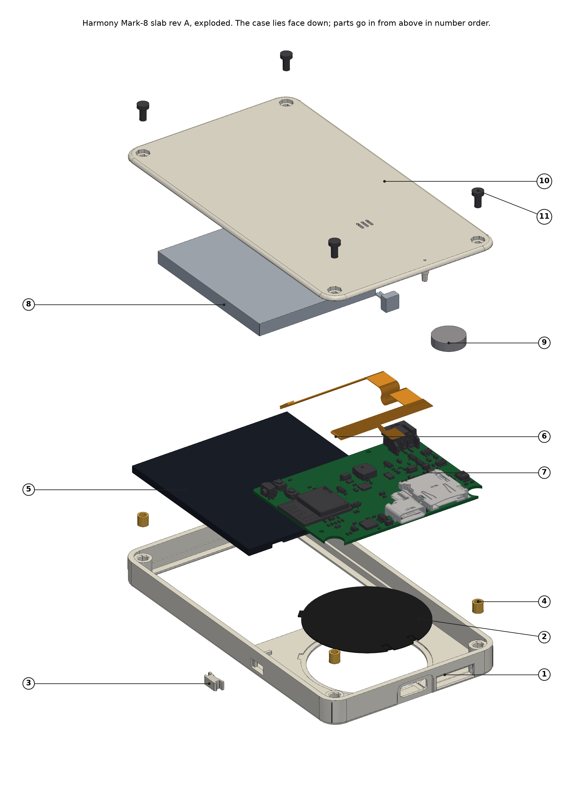
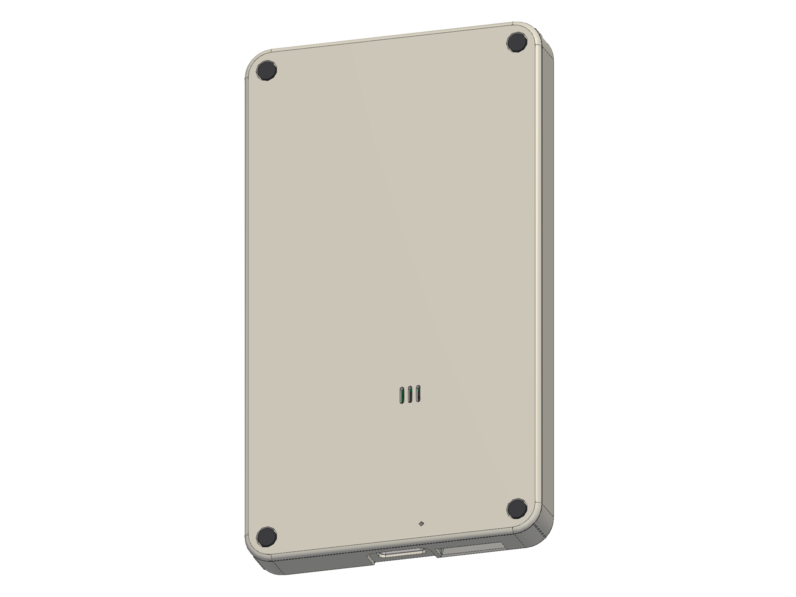
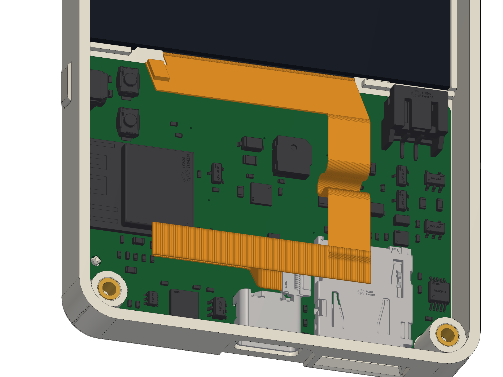

# Harmony Mark-8 slab rev A: assembly

Build time is about 30 minutes once the parts are printed. The only soldering is the optional motor. Flash and test with the back open before you close the case.

The battery plugs into the board before the board goes into the case (steps 6 to 8). Once the board is in, the lower edge of the screen blocks the battery connector J4.

## Parts

| No. | Part | Source | Qty |
| --- | --- | --- | --- |
| 1 | Front shell | Printed, case colour (`print/front-shell.3mf`) | 1 |
| 2 | Wheel disc | Printed, black (`print/wheel-disc.3mf`) | 1 |
| 3 | Side button cap | Printed, case colour (`print/button-cap.3mf`) | 1 |
| 4 | Heat-set insert, M2 x 3 long, about 3.2 OD | Bought | 4 |
| 5 | Screen DLC-T2.7DDS#1 | DigiKey | 1 |
| 6 | Screen FPC (part of the screen; shown folded) | With 5 | - |
| 7 | Main board, assembled | JLCPCB | 1 |
| 8 | LiPo pack 404050 (or 403450), 4.0 mm thick, 1S, protected, JST PH 2.0 plug | Bought | 1 |
| 9 | Vibration motor LCM1027A2445F (optional) | LCSC C2759984 | 1 |
| 10 | Back plate | Printed, case colour (`print/back-plate.3mf`) | 1 |
| 11 | Screw M2 x 4, button head (ISO 7380, head 3.5 x 1.1) | Bought | 4 |

Also: double-sided foam tape 0.2 to 0.5 mm thick (a 35 x 45 piece for the battery), a strip of masking or Kapton tape, and CA glue or foam tape for the motor.

The pack and the foam share 5.15 mm between the screen and the back plate. Use a 4.0 mm pack. With 0.5 mm foam, a pack can be 4.5 mm thick at most. Do not use 1 mm foam: it leaves almost no room for the pack to swell and presses on the back of the screen.

Tools: soldering iron with an M2 heat-set tip (a clean conical tip also works), flush cutters, a fine file, fine tweezers, a plastic spudger or a fingernail, a ruler and a fine marker, a multimeter, a screwdriver for the M2 screws.

## Before you start: cut the board out of its frame

The board arrives in a frame of rails, held by three mouse-bite tabs. Seen from the front of the device, they are on the left edge near the top (next to the battery connector), on the top edge near the right corner, and low on the right edge. The row of holes in each tab sits 0.35 mm outside the board edge, so a cut there leaves a small nub on the board.

1. Hold the board, not the frame. Cut the left tab first, then the other two.
2. Cut each tab with flush cutters along the hole line.
3. File each nub flush with the board edge (it stands up to 0.35 mm proud, with half-hole bumps), then deburr the edge. Lay a straight edge along it: it must lie flat.

Never snap a tab off. Bending the 0.8 mm board can crack a capacitor near the edge or lift a pad of the battery connector. The edges must be flush, because the case has only 0.5 mm of clearance at the side walls. Then do the solder checks of J1 in the build guide (`docs/mark-8-slab-build.md`, section 5).

## Directions on the bench

Lay the front shell face down on a soft cloth with the USB-C opening toward you. From now on:

- "Up" means away from the bench, toward the back of the device.
- The side button wall is on your **left**. The card slot is to the **right** of the USB-C opening.
- The screen end is away from you.

## Steps

1. **Heat-set inserts (4) into the front shell (1).** Set the iron to 210 to 220 C for PLA (240 to 250 C for PETG). Put an insert on each of the four corner bosses. The 0.3 lead-in centres it. Press straight down with light force and let the heat do the work. Stop when the top of the insert is flush with the boss face, or at most 0.1 below it. Hold still for 2 s, then lift the iron. The insert is 3.0 long and the hole is 3.6 deep, so the melted plastic has room under it. Check that each insert is square to the face.

2. **Wheel disc (2) into the front shell (1).** Put the disc in from the inside, labels down. Turn it until its small key tab drops into the notch in the recess. The notch is on the side-button side of the opening, toward the screen end. The disc now sits flush with the front face. Turn the shell over and check that HOME is at the top.

3. **Side button cap (3) into the front shell (1).** From the inside, push the cap head first through the slot in the left wall. The two ears stay inside and rest against the wall. The open slot in the cap faces into the case. Put a strip of tape over the cap on the outside so it cannot fall in before the board holds it.

4. **Screen (5) into its pocket, foam on its back.** Peel the protective film off the front of the screen. Wipe the screen and the window. Lower the screen face down into the pocket with the FPC end toward the wheel. It sits between the two side walls, the top wall and two short lips at its lower corners. Press lightly at the four corners. It must lie flat on the skin. Then stick the 35 x 45 piece of foam tape (0.2 to 0.5 mm) in the middle of the back of the screen. Leave the top liner on for now.

5. **Lift the FPC (6) out of the way.** Bend the FPC up at the screen edge, inside the first 3 mm of the FPC (the thin "single area" next to the glass). Let it stand up out of the case. Do not crease it. The board goes in next and needs the space where the FPC was lying.

6. **Check the battery polarity.** J4 pin 2 is plus (the + mark on the board). Packs with JST PH plugs come wired both ways. With a meter, check that the plug pin that will go into the + side of J4 is the red, positive wire. If it is reversed, do not plug it in: swap the two pins in the plug housing (lift each latch tab with a needle) or use another pack. With USB unplugged, the board blocks a reversed pack. With USB connected, a reversed pack is slowly discharged (about 37 mA) and the charge LED stays on. So never leave a reversed pack on USB.

7. **Battery (8) into J4, with the board out of the case.** Hold the board with the components up and the USB-C receptacle toward you. J4 is the large white connector at the right, at the far edge. Push the plug into J4, toward you, until it latches. The cable leaves J4 toward the far edge.

   Why now: once the board is in the case, the screen's lower edge is only 2.7 mm from the mouth of J4, and it blocks the plug. The plug cannot go in at an angle either. Do not force it: that can lift J4's pads or crack the edge of the screen. When the plug is already in J4, it ends 0.19 mm from the screen edge, and the board goes in with it.

   **First build only.** The firmware README powers the board up the first time without the battery. If you follow it, skip this step: put the pack aside and do steps 8 to 12 and the first bring-up (step 15) without it. Then take the board out ("Take the board out" below), plug in the battery here and put the board back with steps 8 to 12.

8. **Board (7) with the battery onto the locating pins.** Hold the board with the components up and the copper wheel rings down. Hold the pack in your other hand, or lay it on the foam liner on the back of the screen, cable end toward you. Tilt the board so the USB-C end is low. Slide the USB-C receptacle into its opening in the near wall, then lower the far end. Keep the board pushed toward the near wall as you lower it. While the board is tilted, the plug is further from the screen than when the board is flat, so the gap never gets smaller than 0.19 mm. The two pins in the shell go through the two small bare holes: one near the far edge, right of centre, and one near the left edge, about 10 mm from the near end. The side button's small plunger on the left board edge slides into the slot of the cap. Press the board flat. It lies on the skin and on the disc. Its near edge is 0.1 mm from three small standoffs on the near wall. If the board does not drop onto the pins, scrape the faces of the standoffs lightly with a knife.

   Why the board goes in before the FPC tail: the FPC must be lifted first, because flat it covers the board area. The board then has to go in tilted to get the USB-C receptacle into the wall. The screen connector J2 is on the side of the board that now faces up, and the strip in front of its slot is free of tall parts, so the tail slides in flat after the board is in place. If you plug the FPC in first, the tilt-in bends the FPC at the connector.

9. **Fold the FPC tail (6).** Measure 25.2 mm from the contact end of the tail and mark the line across the tail with a fine marker. Fold the end down and under the tail along that line, 180 degrees. Make a soft fold, not a hard crease. After the fold the gold contacts face up, toward you. Pin 1 (the edge of the tail nearer the USB-C end) stays nearer the USB-C end.

10. **Open the J2 latch.** J2 is the small black connector just above the USB-C receptacle, a little right of centre. Its slot faces left. The latch is on its right side. Lift the latch with a fingernail or spudger. It swings up and over to the right, about 90 degrees.

11. **Insert the FPC and close the latch.** Lay the FPC down: the wide part slants down over the far edge of the board, the narrow leg runs toward you on the right of centre, past the square black buzzer, and the folded tail runs across to the left. Slide the folded end flat into the J2 slot from the left, contacts up, pin 1 toward you. Push it straight in until it stops (about 1.3 mm). Close the latch. Pull very gently: the tail must not move.

12. **Settle the extra FPC length, away from the antenna.** The FPC is about 7 mm longer than its path. Let the extra length make one soft loop in the narrow leg, between the buzzer and the card socket. Nothing may press on the loop, and it must stay off the four round bare press pads on the board. See `renders/closeup-fpc-fold.png`.

    The radio antenna is the end of the ESP32 module at the left wall, between the side button and the near left corner screw. Metal and the FPC near it shorten the Bluetooth range. The fold of the tail ends about 3 mm short of the antenna area, and the case cannot move it further: the fold position comes from the FPC length. So keep the fold on its 25.2 mm line and keep the loop in the leg, right of the buzzer. Do not push the fold, the loop or any slack toward the left wall.

13. **Lay the battery (8) on the foam.** Peel the top liner off the foam on the back of the screen. Lay the pack on it, cable end toward you, centred left to right, its near edge about 4 mm from the lower edge of the screen. Press it down lightly. Lay the wires in the gap between the pack and the screen edge. Keep them off the FPC.

14. **Optional motor (9).** Glue the motor into its round seat on the inside of the back plate (10). Solder the red lead to M+ and the other lead to M- (the two labelled pads on the right part of the board, beside the card socket). Leave about 5 mm of slack so the back plate can open.

15. **Test before you close it.** With the back still open, plug in USB-C. Flash the board and run the bring-up test (see `firmware/mark-8/`). Check the screen colour bars, the wheel (all eight sectors and the centre), the side button, the buzzer, the card, the charge LED, the battery reading and the motor if fitted. Unplug USB-C. Fix anything now: it is much easier with the back open.

    Measure the Bluetooth range early, with the back open and again after step 16. Stream to headphones with the player in a pocket, walk away and note where the audio drops. If the closed case loses much more range than the open one, tell the assistant before you close more cases.

16. **Close the back plate (10) with the screws (11).** Lower the back plate with its posts down. The four posts land on the four round bare pads of the board. The lip goes inside the walls. Check all round the edge that no wire or FPC is caught. Put in the four M2 x 4 screws. Tighten in a cross pattern until each head sits in its counterbore, then stop. That is about 0.1 Nm: light finger force on a small driver. Do not use M2 x 5 or longer screws: they bottom out in the two bosses under the screen.

## Take the board out

You need this to plug in, unplug or change the battery, because the screen blocks J4 while the board is in the case.

1. Remove the four screws and lift off the back plate. If the motor is fitted, let the plate hang on its leads.
2. Lift the pack slowly off the foam. Leave the foam on the screen.
3. Open the J2 latch and slide the FPC tail out. Stand the FPC up as in step 5.
4. Lift the far end of the board off the two pins, then slide the USB-C receptacle out of its opening.
5. With the board out of the case, pull the plug out of J4 by its housing, not by the wires. To fit a pack, do steps 6 and 7.
6. Put the board back with steps 8 to 13, then steps 15 and 16.

## Views

Exploded section through press post PP2, the buzzer, J2 and the USB-C receptacle:

Assembled, front and back:

FPC route with the back plate and battery removed:

USB-C opening, card slot and side button:

