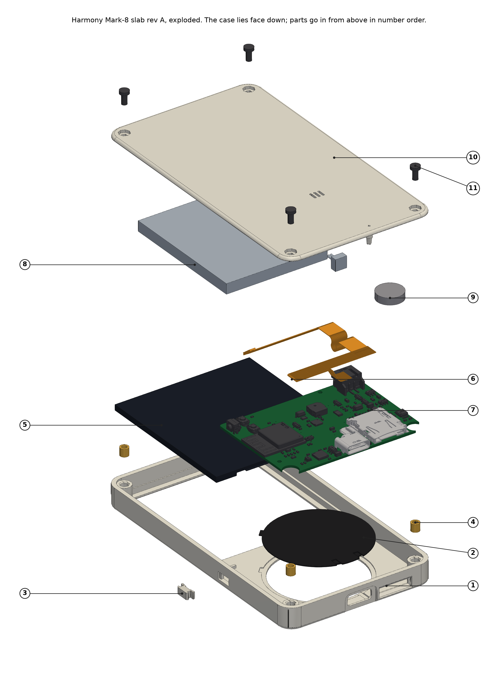
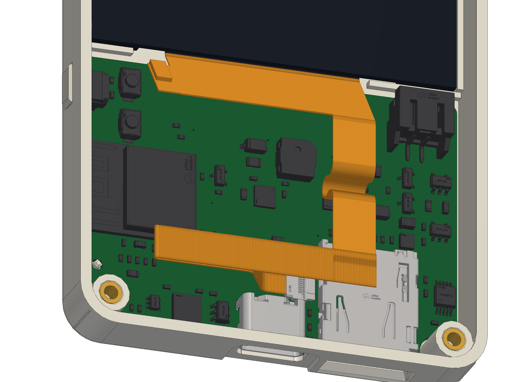

# Harmony Mark-8 "slab" enclosure, revision A

This folder holds the printed case for the Mark-8 slab board (`hardware/mark-8/slab-rev-a/`): four printed parts, the exploded assembly diagram, the assembly steps and the print files. Everything is built from the real board STEP, the vendor screen STEP and `mechanical-interface.json` by one script.

**Status: ready for a first test print. Nothing has been printed yet.** The assembly check finds no unintended overlap between any two parts. The FPC reaches J2 with 7.2 mm of extra length, which goes into one soft loop. Buy a 4.0 mm pack (the YDL 403450, 34 x 52, or a 404050). With 0.5 mm foam the largest pack that fits is 4.65 thick (52 x 48.15 or 43.4 x 52.9 in plan). Read "Check on the first print" before you assemble.

**Updated 21 November 2026** for board revisions A.1 and A.2 and the case items of the pre-order design review (MECH-1 to MECH-7, REG-5), then again for the three faults that the exploded diagram check found (screen corners, top rib, press posts as sliced). See "Changes on 21 November" below.



## Parts

| No. | Part | What it is | Files |
| --- | --- | --- | --- |
| 1 | Front shell | Front skin with the screen window and the wheel opening, side walls, four corner bosses for M2 heat-set inserts, screen pocket, two locating pins, three standoffs on the bottom wall, openings for USB-C, the card and the side button | `step/front-shell.step`, `print/front-shell.*` |
| 2 | Wheel disc | 34.0 dia, 1.0 thick, black. A 0.4 flange behind the skin holds it in; the board presses it from behind. Debossed HOME, previous, next and play/pause | `step/wheel-disc.step`, `print/wheel-disc.*` |
| 3 | Side button cap | Passes through the right wall; ears inside stop it falling out; the head stops on a pocket floor in the wall | `step/button-cap.step`, `print/button-cap.*` |
| 10 | Back plate | 1.2 plate with screw counterbores, a locating lip, four press posts, battery ribs, a channel for the FPC tail, the buzzer grille, the charge LED light tube, and the motor seat | `step/back-plate.step`, `print/back-plate.*` |

`step/assembly.step` holds every part (printed parts, screen, routed FPC, board, battery, plug, motor, inserts, screws) in device coordinates (SPEC 1). Item numbers match `ASSEMBLY.md`.

## Rebuild

```sh
uv run --with cadquery==2.8.0 --with matplotlib --with trimesh --with rtree \
    --with scipy --with markdown python build.py
```

The first run reads the 73 MB board STEP once and caches one BREP per part in `.cache/` (git-ignored); a full run takes about four minutes, most of it the exact interference check. The build writes `step/`, `print/`, `renders/`, `checks/` and `ASSEMBLY.html`, and refreshes the tables in this README between the `auto` markers. It exits with an error if any unintended overlap appears.

| Module | Role |
| --- | --- |
| `params.py` | every dimension; board values read from `mechanical-interface.json` |
| `sources.py` | board STEP cache, screen STEP in device coordinates |
| `parts.py` | the four printed parts |
| `fpc.py` | FPC route and length budget |
| `extras.py` | battery, plug, inserts, screws, motor, touch-side legs |
| `model.py` | the whole assembly and the item numbers |
| `checks.py` | interference, clearances, wall thickness, overhangs, dimensions |
| `export.py` | STEP, STL, 3MF in print orientation |
| `render.py`, `scenes.py` | renders and diagrams |
| `docs.py` | README tables and `ASSEMBLY.html` |

## Changes on 21 November

The board changed in revisions A.1 and A.2. R31 and R32 moved out of the antenna keep-out, R34 and C26 are new, the J1 shell pads are 0.9 wide instead of 1.2, and the antenna copper keep-out now runs to y -18.2. The board ships in a JLC frame with three mouse-bite tabs. The outline, the locating holes and every part height are unchanged. The design review of the same morning (`hardware/mark-8/slab-rev-a/review/2026-11-21-preorder-review.md`) raised seven case items. The case now builds from the new board STEP and `mechanical-interface.json`.

| Item | What changed | Measured result |
| --- | --- | --- |
| MECH-1, battery plug | ASSEMBLY.md: polarity check (step 6) and the plug into J4 (step 7) come before the board goes in. The board tilts in with the pack attached (step 8). New section "Take the board out" for battery service. Step 6 now says what the board does with a reversed pack: it blocks it with USB unplugged; with USB connected the pack is slowly discharged (about 37 mA) and the charge LED stays on. | Tilt sweep in the model, 0 to 25 degrees about two pivots: the plug is never closer than 0.19 to the screen (flat is the closest case; 0.22 at 1 degree, 0.75 at 2) and 0.30 to the front shell. |
| MECH-2, LED light tube | Neck 1.9 OD from z -5.5 to the tip, base 2.3 OD below, 0.15 chamfer on the tip, hole 1.0 and tip height unchanged. The back plate now slices with Arachne walls. | 0.41 to J1 and 0.41 to J3 (was 0.21). In the G-code the neck is one 0.4 bead at r 0.71. |
| MECH-3, foam | 0.2 to 0.5 foam in ASSEMBLY.md and the build guide. The model has a 0.5 foam solid on the screen back, and the pack is stuck on it. | Largest pack 4.65 thick (5.25 less 0.5 foam less 0.1 screen tolerance). A 4.0 pack has 0.75 to the back plate. |
| MECH-4, antenna | Notes in ASSEMBLY.md (step 12 and step 15) and conflict 8. No geometry change. | FPC fold 3.18 left of the keep-out; nearest case metal (bottom right insert and screw) 7.5 below it. |
| MECH-5, card slot | Slot 1.8 tall, z -2.24 to -4.04, on the old centre line; lead-in grows 0.8 in Z so it starts inside the scallop. | A 1.0 card at the drawing estimate clears it by 0.14 (board side) and 0.66; at the JSON plane by 0.40 and 0.40. It prints as z -2.2 to -4.0. |
| MECH-6, USB pull-out | Three standoffs on the inner face of the bottom wall, x -20.9, 13.5 and 20.9. | 0.10 to the board edge; nearest part J3 at 0.60. The review's verifier found that the bottom bosses already stop the board after about 0.2; the standoffs now take the load first and along the edge. |
| MECH-7, side button | No change. | Unchanged: 0.12 at rest, 0.30 past the actuator at the stop against 0.2 travel, so 0.10 margin. Check 4 below keeps the sanding step. |
| REG-5 | Checks rerun against the new STEP (85 board solids, all matched) and JSON. | 273 pairs, 0 unintended overlaps. R31, R32, R34 and C26: 1.51 or more to the FPC, 4.0 or more to any case part behind the board (table below). |
| Frame tabs | ASSEMBLY.md "Before you start" agrees with the build guide, section 5. | Filed flush: 0.49 to the side walls (left, right), 1.20 to the screen lips (top). A 0.35 nub left on: 0.15. At the right tab the bottom right boss is 0.35 from the board corner, as before. |
| Exploded diagram check (`diagram/`) | Three faults found by measuring the STEP files and the sliced plate, then fixed: (1) the walls' R3.9 inner corners stood 0.56 into the screen's top corners, and the check had called that 1.42 mm3 a face contact; the pocket is now cut into the walls, and a face contact may no longer share volume. (2) The top battery rib blocked the 52 mm YDL 403450; the rib is gone, the two low ribs moved 0.5 down, and the pack model now sits on the foam, so the back plate is checked against it. (3) At 0.2 layers the rim and boss faces printed 0.1 taller, so the case was 9.6 and the posts had no press; T is now 9.6 with every fit height a whole layer, and the posts press 0.2. Also the USB-C opening is 9.6 x 3.8 (z -1.6 to -5.4) and the LED tube top is z -3.0. | 273 pairs, 0 unintended overlaps; screen to shell 0.000 mm3; the YDL 403450 fits with no overlap; posts 0.2 each (5.65 mm3 in all); LED tube 0.41 to J1 and 0.415 to J3; FPC fold 25.24 from the contact end, slack 7.13. |
| J1 pads 0.9 | The skin reliefs and disc pockets follow the JSON, so they are 0.3 narrower and stay 0.5 larger than the pads. | Legs to the reliefs and pockets 0.10, as before. |

Why the smaller tube for MECH-2: it keeps a closed tube and the same 1.0 hole at the same height over the LED, so the light reaching the outside does not change, and it gives 0.41. Ending the tube below J3 (z -3.69; -3.74 in the board STEP) does not help on the J1 side, because the J1 shell reaches z -5.06 (-5.10 in the STEP); the tube would stay 0.21 from it and let more light spill. A half shroud removes the walls next to J1 and J3. Light then leaks into the case below them and the white PLA glows around the hole, and the open ends are thin fins. The base stays 2.3 OD because it sits 0.44 below the J1 shell. The 0.45 neck wall needs Arachne walls: with classic walls Bambu Studio lays two loops 0.07 apart there, about 45 % too much plastic, which would eat the new clearance.

## How the 13 known conflicts were resolved

1. **Wheel disc flange.** As proposed. The skin's inner face has a ring recess from r 17.15 to 18.65, 0.4 deep, so the skin is 0.6 there. The disc has a 0.4 flange from r 17.0 to 18.5 that sits in the recess. The board presses the flange from behind; the disc front is flush, the disc is 1.0 over the electrodes and its back lies flat on L4. Opening clearance 0.15 radial. The flange lies on L4 between r 17.0 and 18.5: over the bare gap (16.6 to 17.6) and the GND pour (from 17.6), never over an electrode. At the top of the wheel the flange reaches 0.75 past the board's top edge (y -10.0); that part of the ring is held by the rest of the flange. I added a key tab on the flange at 45 degrees (upper right from the front), because the disc must go in one way: the labels and the USB-C leg pockets (item 3) fix its rotation.
2. **Top bosses.** Kept at (+-24.7, +47.15). They stop at z -3.6, 0.45 below the screen back. The insert goes in from the back; the hole is 3.6 deep from the boss face at z -7.8, which leaves a 0.6 roof. The bottom bosses sit in the board notches and run up to the skin.
3. **Touch-side protrusions.** One relief per side, 0.5 deep and 0.5 larger than the pads on every side, covering both USB-C legs on that side. Since board revision A.1 the pads are 0.9 wide, so the reliefs are 1.9 wide. One box per side, rather than one per pad, leaves no thin ridge between the reliefs, the disc recess and the flange. The two rear legs sit under the disc's lower edge (they reach r 15.5), so the disc has matching 0.5 pockets and the flange is cut there. Clearance to the legs: 0.1 up, 0.5 sideways.
4. **USB-C opening.** The receptacle face is at y -50.4, 1.35 behind the outer face. USB-IF gives the receptacle shell length as 6.20 (a reference value in an ECN), and as I recall the USB Type-C spec keeps a plug's overmold at least 6.65 behind its tip, so a plug only seats fully when the overmold can come to about 0.45 from the receptacle face. A plain 9 x 3.4 hole would stop a normal overmold 0.9 short, which risks poor contact and no latch. So the wall has a 9.6 x 3.8 R1.0 opening from z -1.6 to -5.4, 0.3 or more from the receptacle shell on every side (the shell pokes 0.25 into the wall) inside a port recess 12.6 wide, 0.9 deep, from z -6.76 out through the front edge round. Any overmold up to 12.35 x 6.5 (the spec limit) now reaches y -50.85, 0.45 from the receptacle face. The recess runs out through the edge round because a recess that stops inside the round leaves a feather edge that cannot print. It is not visible from straight in front. The 6.5 overmold height does not fit under the 1.0 skin otherwise.
5. **microSD.** Slot 11.4 x 1.8, x -19.4 to -8.0, z -2.24 to -4.04 (it prints as z -2.2 to -4.0), with a lead-in from the scallop. The JSON card plane (z -3.14) comes from a vendor 3D model that is 0.21 taller than the Hirose drawing, so the slot was 1.4 and is now 1.8 (review MECH-5). It takes a 1.0 card at the drawing estimate (z -2.38 to -3.38) and at the JSON plane (z -2.64 to -3.64); see the clearance table. A finger scallop (R3.0 along X, 0.9 deep, x -20.2 to -7.2) thins the wall outside the slot. A locked card's edge is at y -50.69 (JSON lock position), 0.16 inside the scallop floor; pushing it 1 mm past the lock point needs a fingernail 1.2 mm into a 1.8 slot. An ejected card stands 2.9 out of the outer face and 3.8 past the scallop floor, enough to grip with two fingernails.
6. **Side button.** The cap is a 2.6 tall flat part (it prints lying down): head 5.6 wide, stem 4.0, ears 6.8. The stem passes a 4.3 x 2.9 slot; the head sits in a 6.0 wide pocket. At rest the ears rest on the inside of the wall, the head stands 0.5 proud and the plunger is 0.12 from the actuator tip. The head stops on the pocket floor after 0.42 travel: 0.12 gap, 0.2 switch travel, 0.1 for print tolerance. The flange is 0.4 thick in front of the switch body and 0.6 at the ears, so it stays clear of SW1's body and tabs at the stop. The plunger sits at the bottom of a slot that is open top and bottom, so the board's actuator slides into it when the board goes in.
7. **FPC path.** See "FPC route and length" below. Short version: the FPC's wide section is stiff (two layers plus a stiffener under a part) and too long to drop straight down, so it bends 37 degrees in the single area and runs on a straight slant under the board, which is free of parts there. The leg then lies on the back plate. **The fold apex is at x 18.52 (fold line 25.2 mm from the contact end).** Along Y the FPC is 7.2 mm too long for the J2 position (y -39.0); that length goes into one loop in the leg. The tail's first layer lies in a 0.3 deep channel in the back plate that keeps it in line with J2. No ribs or posts are in the dive, run or ramp zones.
8. **Antenna.** No screw, insert, boss or thickened wall within the keep-out (x 21.8 to 27.2, y -37.9 to -18.2 since board revision A.1) or within 5 mm beyond the right wall. The right wall is 1.6 there. The only plastic near it is the back plate lip (0.8 x 0.8, thinner than the wall) and the ears of the button cap (0.6 thick, at y -19.0 to -18.2). The nearest metal in the case is the bottom right insert and screw head, 7.5 below the keep-out and 9.5 below the antenna itself. This is still much less than the 15 mm all round that Espressif recommends (review MECH-4). The nearest FPC parts are the fold of the tail (x 18.62) and the wing beside the FPC part (x 17.9), about 3 mm left of the keep-out. The case cannot move them further at no cost: the fold position is set by the FPC length and J2, and each 1 mm to the left needs 2 mm more loop. ASSEMBLY.md tells the builder to keep the fold and the loop where the model puts them, and to measure the Bluetooth range early.
9. **Battery.** The pocket is under the screen, from the back plate (z -8.4) to the screen back (z -3.15): 5.25. The pack is stuck to 0.2 to 0.5 foam on the screen back; the model uses 0.5. The screen is 2.15 +-0.10 thick, so the largest pack is 5.25 - 0.5 - 0.1 = 4.65 thick (4.95 with 0.2 foam). A 4.0 pack on 0.5 foam leaves 0.75 for swelling. Do not use 1 mm foam: it leaves 0.25 over a 4.0 pack, less with a thick screen, and presses on the panel (review MECH-3). The pack's lower edge is at y -4.0, 3.84 from the screen's lower edge (ASSEMBLY step 13 says 4 mm), which leaves a cable bay between the pack and the screen edge for the leads to J4. Two low ribs (1.2 tall) 0.3 below that edge keep the pack out of the cable bay, and two side ribs locate a 404050; a 34 wide 403450 needs a 3 mm foam strip at each side. There is no top rib: the back plate lip stops a pack up to 53 long. The YDL 403450 (34 x 52 with its protection board) ends at y 48.0, 1.2 from the lip. Until the diagram check of November 21 a top rib at y 46.8 to 47.6 blocked any pack longer than 50.3. A pack wider than 40 needs the two side ribs cut off with flush cutters. The largest pack: see "Battery fit". The cable runs from the pack's near edge to J4 at x -21, well clear of the FPC dive zone (x -14 to 19).
10. **Board retention.** Pins 1.45 dia (0.075 radial clearance in the 1.6 holes, so the board can go in tilted for the USB-C end), tips at z -2.4 (0.6 past the component side) with a 0.35 chamfer. Nothing sits over either pin. The bottom bosses in the board notches stop the board after about 0.2 in Y. Three standoffs on the inner face of the bottom wall (x -20.9, 13.5 and 20.9; 1.6 wide, from the skin to z -2.2, 0.3 chamfer on the back edge) close the 0.55 gap to the board's bottom edge to 0.1, so a USB-C pull goes into the wall, not into the pins (review MECH-6). Press posts on PP1 to PP4: 3.0 dia tip from z -1.6 (0.2 interference with the pad; at 0.2 layers the press can only be 0.0 or 0.2) to -4.0, a cone to 4.4 dia at -5.0, then 4.4 to the plate. Each post clears its neighbours by 0.95 or more.
11. **Buzzer grille and charge LED.** Three slots 0.8 x 3.4 at 1.6 pitch, centred on BZ1 (4.0 x 3.4 overall). LED: a 1.0 hole at x -5.83 (0.07 right of the LED, to centre the tube in the 2.7 gap between J3 and J1) and a closed light tube from the plate to z -3.0, 0.5 short of the LED top. The tube is 2.3 OD from the plate to z -5.5 (below the J1 shell) and 1.9 OD above, where it passes J1 and J3, with a 0.15 chamfer on the tip (review MECH-2). See "Changes on 21 November" for why this option.
12. **Motor.** A round seat 10.4 dia, 0.3 deep, in the back plate at (-20.0, -39.5). Both motor pads lie within 4.3 of the motor centre. The seat is outside every FPC zone (the leg zone starts at x -13.7), 1.1 from the bottom left boss and 0.7 from post PP1.
13. **Screen pocket.** Window = active area plus 0.3 (49.56 x 49.56, R1.5) with a 0.4 x 45 degree chamfer on its front edge, which prints in the first two layers. The walls are thickened to 0.15 from the screen outline along both sides and the top (z -1.0 to -3.15), and two 0.8 lips under the screen's lower corners (outside the FPC exit) stop it in -Y. So the screen registers to +-0.15 in X and Y. The screen's two top corners lie outside the walls' R3.9 inner corners, so the pocket is cut into the walls there; about 0.95 of wall is left inside the R5.5 outer corner. Until the diagram check of November 21 the CAD did not cut the walls, and they stood 0.56 into both corners of the screen. The measured centre of the window and of the active area agree within 0.002.

## Changes from spec

| Spec | Built | Why |
| --- | --- | --- |
| Plan corner radius 6.5 (SPEC 2) | 5.5 | With R6.5 the screen's top corners (x +-26.68, y 49.65, corner radius under 0.1) sit 0.63 from the outer surface, and a pocket with clearance leaves about 0.4 of wall. R5.5 is the smallest change that leaves 0.83 at a sharp pocket corner (about 0.95 at the pocket's R0.3 corners). |
| Battery up to 52 x 54 x 4.8 (SPEC 8, 10) | Largest that fits: 52 x 48.15 x 4.65 or 43.4 x 52.9 x 4.65, with 0.5 foam | A 52 x 54 block hits the two top bosses (and the top wall). The pack also needs the cable bay. A 4.8 pack fits only on 0.2 foam. 404050 and 403450 (4.0) fit. |
| M2 x 4 or x 5 screws (SPEC 10) | M2 x 4 only | An M2 x 5 bottoms out in the top bosses, which must stop under the screen. |
| FPC: drop in the 2.16 gap, run flat, fold near x +21 (SPEC 3.1) | Slanted wide section, loop in the leg, fold apex at x 18.52 | The real FPC's wide section is stiff and 10.8 long, more than the 6.8 drop; and the FPC is 7.2 mm longer in Y than the J2 position needs. The fold position comes from the real length and J2 at x_c -2.24. |
| Locating pins "about 1.5" (brief) | 1.45 | 0.075 radial clearance, for the tilted board insertion. |
| USB-C opening "about 9.0 x 3.4" (brief) | 9.6 x 3.8 inside a 12.6 x 6.6 port recess, 0.9 deep | Full plug mating, see conflict 4. |
| Thickness T 9.5 (SPEC 2) | 9.6, back plate inner face at z -8.4 | At 0.2 layers every height must be a whole number of layers above the part's print bed. At 9.5 the shell's rim and boss faces (8.3 and 7.7 above its front face) printed at 8.4 and 7.8, so the printed case was 9.6 anyway and the press posts lost their press (diagram G-code check, November 21). |

All other SPEC 2 values are built as written: outline 58.6 x 103.5, edge round 1.0, wall 1.6, skin 1.0, back plate 1.2, four M2 inserts at (+-24.7, +-47.15).

## Decisions I made

1. The back plate covers the full outline (parting line on the sides at z -8.4) and has a 0.8 x 0.8 lip inside the walls for location, with square breaks at the bosses.
2. The boss joint is at z -7.8: 0.6 tall screw pads on the back plate meet the shell bosses there. The insert is flush with the shell boss face. The counterbore is 4.2 x 1.1, which leaves 0.7 under the head and gives a flush ISO 7380 button head.
3. Insert: M2 x 3 long, 3.2 OD (SPEC 10). Hole 3.0 dia, 3.6 deep, 0.3 lead-in. Boss 5.4 dia, so the boss wall is 1.2. The bottom bosses have 0.2 clearance in the board notches (r 2.9).
4. The wheel disc prints with its back on the plate. Face down, its flange would overhang. Ironing gives the front a smooth top surface.
5. The disc has an orientation key and pockets for the two rear USB-C legs (conflicts 1 and 3).
6. HOME is Arial Bold 3.2, letter by letter with 0.6 gaps; previous, next and play/pause are drawn icons with gaps of at least 0.45. All are debossed 0.4.
7. The side button cap is a flat 2.5D part that prints lying down with no overhang, and the stem is rectangular so the cap cannot turn.
8. The FPC route is one plausible shape for a loose FPC: the model lays it 0.02 above the plate and puts the extra length in one loop. In the case it floats between the board parts and the plate; the free height above the leg is at least 4.5.
9. FPC insertion depth into the FH35C is taken as 1.3 from the mouth. Each 0.1 of error moves the fold line 0.05.
10. The battery plug (JST PHR-2) is modelled from the J4 cavity in the board STEP (4.5 x 4.5, 2.5 out of J4). It clears the screen edge by 0.19 and the screen lips by 0.3. With the board in the case, the screen edge blocks the plug's path into J4, so the plug goes into J4 before the board goes in (ASSEMBLY.md steps 6 to 8, review MECH-1).
11. The board goes in before the FPC tail is folded and plugged (ASSEMBLY.md step 8 says why).
12. Screen pocket clearance is 0.15 per side; the screen outline tolerance is +-0.2.
13. The front shell needs no supports. The only real overhang is the two top boss shelves.
14. Colours in the renders: case off-white, disc black. Dave picks the case colour.

## FPC route and length

<!-- auto:fpc -->
| Item | Value |
| --- | --- |
| FPC centre line, flat (vendor STEP): exit to tail centre line (Y) / leg centre to tip (X) / total | 40.59 / 54.07 / 94.66 |
| Routed centre line, same three | 40.59 / 54.07 / 94.66 |
| Exit from the screen | y -7.84, z -1.515 (FPC mid plane) |
| Wide section | bends 37.9 deg down in the single area (R 1.0), runs straight 10.34 under the board, second bend (R 1.0) lays the leg on the plate at y -17.23 |
| Tail centre line if the leg ran straight | y -46.13 (J2 slot centre is y -39.0) |
| **Slack along Y** | **7.13**, taken by one loop in the leg: R 1.5, height 4.43, from y -23.5 to -28.8 |
| **Fold** | fold starts at x 18.22; fold apex x 18.52 (mid plane), 18.62 (outside); inner radius 0.2 |
| **Fold line measured from the tail end** | **25.2 mm** along the FPC from the contact end |
| Slack along X | 0.0: the fold position takes up the X length exactly |
| Layers on the plate | first layer z -8.68 to -8.48 (in a 0.3 channel), folded layer z -8.08 to -7.88 |
| Rise to J2 | S-curve R 1.5, 60 deg, from x 5.23 to 0.16; flat for 3.70 (stiffener plus 0.2) into the slot; tip at x -3.538 (1.3 inside the mouth) |
<!-- /auto:fpc -->



## Battery fit

<!-- auto:battery -->
| Item | Value |
| --- | --- |
| Height from the back plate to the screen back | 5.25 |
| Less the foam (0.5) and the screen thickness tolerance (0.1): largest pack thickness | 4.65 |
| Largest pack, full width | 52.0 x 48.15 x 4.65 (stops 0.3 short of the top bosses) |
| Largest pack, narrow enough to pass the top bosses | 43.4 x 52.90 x 4.65 (stops 0.3 short of the back plate lip) |
| Pack lower edge | y -4.0 (cable bay from the screen edge to here) |
| battery largest, full width | fits |
| battery largest, narrow | fits |
| battery 403450 | fits |
| battery SPEC 52 x 54 x 4.8 block | does not fit: front shell, insert 3, insert 4, screw 3, screw 4 |
<!-- /auto:battery -->

## Checks

### Interference

<!-- auto:interference -->
Pairs checked with exact solids: 273 (bounding boxes overlap; board-to-board and screen-to-screen pairs skipped). Tolerance 0.001 mm^3. Unintended overlaps: **0**.

| Part | Part | Overlap mm^3 | Status | Why |
| --- | --- | --- | --- | --- |
| front shell | wheel disc | 0.000 | ok | disc flange seats in the skin recess (face contact) |
| front shell | button cap | 0.000 | ok | cap flange rests on the wall inner face (face contact) |
| front shell | insert 1 | 2.679 | ok | heat-set knurl 3.2 OD in the 3.0 hole, melts in |
| front shell | insert 2 | 2.679 | ok | heat-set knurl 3.2 OD in the 3.0 hole, melts in |
| front shell | insert 3 | 2.679 | ok | heat-set knurl 3.2 OD in the 3.0 hole, melts in |
| front shell | insert 4 | 2.679 | ok | heat-set knurl 3.2 OD in the 3.0 hole, melts in |
| front shell | screen body | 0.000 | ok | screen front rim on the skin (face contact) |
| front shell | board PCB | 0.000 | ok | board touch side lies on the skin (face contact) |
| wheel disc | board PCB | 0.000 | ok | disc back face lies on L4 (face contact) |
| back plate | screw 1 | 0.000 | ok | head seats in the counterbore |
| back plate | screw 2 | 0.000 | ok | head seats in the counterbore |
| back plate | screw 3 | 0.000 | ok | head seats in the counterbore |
| back plate | screw 4 | 0.000 | ok | head seats in the counterbore |
| back plate | board PCB | 5.655 | ok | press posts on PP1 to PP4, 0.2 planned interference each |
| back plate | motor | 0.000 | ok | motor glued in its seat on the back plate |
| screen body | battery foam | 0.000 | ok | foam stuck on the screen back (face contact) |
| screen FPC bonded end | FPC leg and wide section | 0.000 | ok | same FPC, cut at the screen edge |
| FPC tail | board J2 | 0.409 | ok | FPC end inserted 1.3 into the J2 slot |
| board J4 | battery plug PHR-2 | 0.000 | ok | plug mated in J4 (face contact at the J4 face) |
| battery plug PHR-2 | battery wires | 0.016 | ok | same cable |

Face contacts that the check counts as touching (0 volume) are listed when they are planned.

Reference solids (not built, checked against the case):

| Solid | Size (mm) | Fits | Overlaps |
| --- | --- | --- | --- |
| battery largest, full width | 52.0 x 48.15 x 4.65 | yes | none |
| battery largest, narrow | 43.4 x 52.9 x 4.65 | yes | none |
| battery 403450 | 34.0 x 52.0 x 4.0 | yes | none |
| battery SPEC 52 x 54 x 4.8 block | 52.0 x 54.0 x 4.8 | NO | front shell 103.906, insert 3 13.561, insert 4 13.561, screw 3 12.409, screw 4 12.409 |
<!-- /auto:interference -->

### Clearances (near misses)

<!-- auto:clearances -->
| Near miss | Clearance (mm) |
| --- | --- |
| FPC leg and wide section to SW2 | 1.10 |
| FPC tail to C20 | 1.10 |
| FPC tail to J1 | 1.10 |
| FPC leg and wide section to D1 | 1.21 |
| FPC part to SW2 | 1.24 |
| FPC leg and wide section to R17 | 1.35 |
| FPC to the board itself (under J2, at the S-curve top) | 0.30 |
| FPC to the front shell / back plate / disc | 0.41 / 0.02 (floats 0.02 over the plate in the model) / 0.96 |
| FPC to the motor / battery / battery plug | 1.78 / 4.35 / 5.48 |
| 404050 pack to the top bosses | 2.14 |
| 404050 pack to the front shell (any feature) | 2.14 |
| 404050 pack to the back plate side ribs (each side) | 0.30 |
| 404050 pack (4.0, on 0.5 foam on the screen back) to the back plate | 0.75 (any feature: 0.30) |
| Battery plug to the screen / to the front shell lips | 0.19 / 0.30 |
| Button cap to SW1 at rest | 0.12 |
| Button cap at its stop (0.42 travel): plunger past the actuator rest tip | 0.30 (switch travel 0.2) |
| Button cap flange to the SW1 body at the stop | 0.12 |
| Press post PP1 to U4 | 1.10 |
| Press post PP2 to C19 | 1.47 |
| Press post PP3 to Q5 | 1.30 |
| Press post PP4 to Q6 | 0.95 |
| LED light tube to LED1 | 0.45 |
| LED light tube to J1 | 0.41 |
| LED light tube to J3 | 0.41 |
| LED light tube to R8 | 1.29 |
| Pin H1 in its hole (radial) | 0.075 |
| Pin H2 in its hole (radial) | 0.075 |
| USB-C legs to the skin reliefs / to the disc pockets | 0.10 / 0.10 |
| Motor to the nearest board part | 2.24 |
| Screen back to the top bosses | 0.45 |
| Bottom wall standoff at x -20.9 to the board edge / to J3 | 0.10 / 0.60 |
| Bottom wall standoff at x 13.5 to the board edge / to R1 | 0.10 / 1.79 |
| Bottom wall standoff at x 20.9 to the board edge / to R4 | 0.10 / 2.80 |
| R31 (15.5, -12.1, FPC run zone) to the FPC part / to the screen body (behind the board) | 1.54 / 4.01 |
| R32 (13.3, -18.6, FPC run zone) to the FPC leg and wide section / to the back plate (behind the board) | 5.60 / 5.02 |
| R34 (-13.85, -24.3, FPC run zone) to the FPC leg and wide section / to the back plate (behind the board) | 1.94 / 6.20 |
| C26 (-14.36, -25.7, general) to the FPC leg and wide section / to the back plate (behind the board) | 1.67 / 6.05 |
| Frame tab, left edge (-17.9 to -13.1), to the front shell: filed flush / 0.35 nub left | 0.49 / 0.15 |
| Frame tab, top edge (22.1 to 26.1), to the front shell: filed flush / 0.35 nub left | 1.20 / 0.86 |
| Frame tab, right edge (-45.4 to -40.6), to the front shell: filed flush / 0.35 nub left | 0.35 / 0.15 |
| 1.0 card at the drawing estimate (z -2.38 to -3.38) to the slot, board side / back side | 0.14 / 0.66 |
| 1.0 card at the JSON card plane (z -2.641 to -3.641) to the slot, board side / back side | 0.40 / 0.40 |
| Board tilt-in with the plug in J4 (0 to 25 deg about the touch-side bottom edge (y -49.6, z -1.0)): plug to the screen / to the front shell | 0.19 / 0.30 |
| Board tilt-in with the plug in J4 (0 to 25 deg about the USB-C shell, front top edge (y -50.4, z -1.8)): plug to the screen / to the front shell | 0.19 / 0.30 |
<!-- /auto:clearances -->

### Printability

Rules: no wall under 0.8 except where noted; no overhang over 45 degrees unless bridged; heat-set boss wall at least 1.2 around a hole sized for the insert (M2 x 3, 3.2 OD; hole 3.0; boss 5.4, wall 1.2); screw counterbores in the back plate (4.2 x 1.1, 2.4 clearance hole). Wall thickness is measured by casting rays inward from about 100 000 surface points per part and keeping hits on an opposite face; the outer edge rounds are left out.

<!-- auto:printability -->
| Part | Thinnest wall found | Spots under 0.8 | Where and why |
| --- | --- | --- | --- |
| front shell | 0.50 | 5 | skin over the disc flange recess (0.6) and the USB-C leg reliefs (0.5), by design (brief items 1 and 3) (0.50); roof over the insert hole in a top boss, 0.5 (0.60); bottom wall behind the USB-C port recess, 0.7 (0.70); bottom wall at the microSD scallop, 0.7 (0.70) |
| back plate | 0.45 | 5 | LED light tube neck beside J1 and J3, 0.45 (MECH-2) (0.45); plastic under the screw head, 0.7 (0.70) |
| wheel disc | 0.03 | 5 | ridges inside the debossed HOME letters (corners of M and E); they print slightly rounded (0.03); flange and key tab, 0.4 by design (brief item 1) (0.40); under a debossed label, 0.6 (0.55) |
| button cap | 0.40 | 4 | flange: 0.4 in front of SW1, 0.6 at the ears (space between SW1 and the wall) (0.40); head corners (0.6 round on the 0.7 head) (0.64) |

| Part | Overhangs over 45 deg (print orientation, above the first 0.3) | Where and why |
| --- | --- | --- |
| front shell | 8 areas | top boss shelf over the screen corner: corner overhang about 3 mm: 4 areas, 47.2 mm^2; top of the USB-C opening and overmold pocket: short bridge: 2 areas, 17.0 mm^2; top of the button slot and pocket: short bridge: 1 areas, 7.9 mm^2; top of the microSD slot and scallop: short bridge, scallop is 46 deg at most: 1 areas, 4.6 mm^2 |
| back plate | 4 areas | ceiling of a screw counterbore: 0.9 wide ring, bridged: 4 areas, 37.3 mm^2 |
| wheel disc | 2 areas | ceiling of a USB-C leg relief on the bed side: 2 x 3 bridge: 2 areas, 7.3 mm^2 |
| button cap | 0 areas | none |
<!-- /auto:printability -->

### Dimensions

<!-- auto:dims -->
| Check | Target | Measured |
| --- | --- | --- |
| Outline X | 58.6 | 58.600 |
| Outline Y | 103.5 | 103.500 |
| Thickness T | 9.6 (9.5 in SPEC 2; whole 0.2 layers) | 9.600 (z -9.6 to 0.0) |
| Active area from the screen STEP (polarizer less 1.25) | SPEC x +-24.48, y -1.51 to 47.45 | x -24.481 to 24.479, y -1.512 to 47.448 |
| Window in the skin (measured at z -0.7) | AA plus 0.3 | x -24.777 to 24.777, y -1.807 to 47.748 |
| Active area centred in the window | within 0.1 | offset x +0.001, y +0.002 |
<!-- /auto:dims -->

## Check on the first print

1. **FPC fold and slack.** Before you print the back plate, dry-fit: screen, board, fold the tail at 25.2 mm from the contact end and plug it into J2. Check that the loop sits between the buzzer and the card socket without touching the press pads. If the tail lands off the slot in Y, the loop size is wrong, not the fold.
2. **USB-C.** Plug in two or three of your cables, including the fattest. Each should click in fully. Also check the board's tilt-in: the receptacle must slide into its opening without force.
3. **Top corners and top bosses.** Look at the two top corners of the screen pocket (wall about 0.95) and the two top boss shelves (corner overhang). If a shelf sags onto the screen area, scrape it.
4. **Side button feel.** It should click before the head bottoms out. If it does not, sand the inside face of the head (it sets the stop).
5. **Wheel disc.** It should drop in, sit flush and not rock. If it rocks, a USB-C leg is touching: check the pocket on the back of the disc.
6. **Screen.** It should drop in with almost no play and lie flat. Check that the window shows the whole active area evenly.
7. **Board onto the pins.** The board's near edge sits 0.1 from the three standoffs on the bottom wall. The board should drop onto both pins without force. If it does not, scrape the faces of the standoffs lightly. With a cable plugged in, pull it out: the board must not move.
8. **Card slot.** Push a card in until it locks, then push again to eject it. It should not rub the top or the bottom of the slot. If it rubs, note which side: the card height in J3 is not measured yet.
9. **LED light tube and posts.** The back plate must sit flat on the bosses with the tube between J1 and J3. The four posts press the board 0.2. If the plate stands off the rim near a post with the screws in, sand that post tip lightly. With USB plugged in, the red LED should show through the hole.
10. **Bluetooth range.** Measure it with the back open and closed, early (ASSEMBLY.md step 15).

## Open risks

- The FPC route, the fold and the loop come from the vendor STEP, not from a real part (SPEC 11).
- The FH35C insertion depth (1.3) is an estimate from the crude connector model.
- The USB-C mating numbers (6.20, 6.65) are from the USB-IF ECN and my reading of the Type-C spec; check with real cables.
- The battery plug size is estimated from the J4 model.
- Touch through 1.0 of black PLA is not yet tried; 1.6 of PLA works on the bench.
- The card height in J3 comes from the Hirose drawing and a vendor model that disagree by 0.21 (MECH-5). The 1.8 slot covers both; measure the real height on the first board.
- The antenna has far less than Espressif's 15 mm of clear space (MECH-4). Range in the closed case is not known.
- The battery plug clears the screen edge by only 0.19, and only if the board is pushed toward the USB-C wall while it goes in (ASSEMBLY.md step 8).

## Files

<!-- auto:files -->
| File | Size | LFS |
| --- | --- | --- |
| step/assembly.step | 84.87 MB | yes |
| step/back-plate.step | 0.42 MB |  |
| step/button-cap.step | 0.08 MB |  |
| step/front-shell.step | 0.65 MB |  |
| step/wheel-disc.step | 0.44 MB |  |
| print/back-plate.3mf | 0.28 MB | yes |
| print/back-plate.stl | 1.24 MB | yes |
| print/button-cap.3mf | 0.00 MB | yes |
| print/button-cap.stl | 0.02 MB |  |
| print/case-colour-plate.3mf | 0.54 MB | yes |
| print/front-shell.3mf | 0.26 MB | yes |
| print/front-shell.stl | 1.16 MB | yes |
| print/mark8-slab-p2s.3mf | 0.60 MB | yes |
| print/mark8-slab-p2s.gcode.3mf | 1.31 MB | yes |
| print/wheel-disc.3mf | 0.03 MB | yes |
| print/wheel-disc.stl | 0.14 MB |  |
| renders/assembled-back.png | 0.11 MB |  |
| renders/assembled-front.png | 0.13 MB |  |
| renders/closeup-fpc-fold.png | 0.43 MB |  |
| renders/closeup-side-button.png | 0.09 MB |  |
| renders/closeup-usb-microsd-inside.png | 0.38 MB |  |
| renders/closeup-usb-microsd.png | 0.23 MB |  |
| renders/exploded-isometric.png | 0.57 MB |  |
| renders/exploded-isometric.svg | 0.88 MB |  |
| renders/exploded-section.png | 0.18 MB |  |
| renders/exploded-section.svg | 0.55 MB |  |
| checks/battery-fit.json | 0.00 MB |  |
| checks/dimensions.json | 0.00 MB |  |
| checks/fpc-route.json | 0.01 MB |  |
| checks/interference.json | 0.02 MB |  |
| checks/interference.md | 0.01 MB |  |
| checks/printability.json | 0.01 MB |  |
| checks/printability.md | 0.00 MB |  |
<!-- /auto:files -->

Large binaries for Git LFS (exact-path rules, as in the repo's `.gitattributes`):

<!-- auto:lfs -->
```
"enclosure/mark-8/slab-rev-a/step/assembly.step" filter=lfs diff=lfs merge=lfs -text
"enclosure/mark-8/slab-rev-a/print/back-plate.3mf" filter=lfs diff=lfs merge=lfs -text
"enclosure/mark-8/slab-rev-a/print/back-plate.stl" filter=lfs diff=lfs merge=lfs -text
"enclosure/mark-8/slab-rev-a/print/button-cap.3mf" filter=lfs diff=lfs merge=lfs -text
"enclosure/mark-8/slab-rev-a/print/case-colour-plate.3mf" filter=lfs diff=lfs merge=lfs -text
"enclosure/mark-8/slab-rev-a/print/front-shell.3mf" filter=lfs diff=lfs merge=lfs -text
"enclosure/mark-8/slab-rev-a/print/front-shell.stl" filter=lfs diff=lfs merge=lfs -text
"enclosure/mark-8/slab-rev-a/print/mark8-slab-p2s.3mf" filter=lfs diff=lfs merge=lfs -text
"enclosure/mark-8/slab-rev-a/print/mark8-slab-p2s.gcode.3mf" filter=lfs diff=lfs merge=lfs -text
"enclosure/mark-8/slab-rev-a/print/wheel-disc.3mf" filter=lfs diff=lfs merge=lfs -text
```
<!-- /auto:lfs -->
