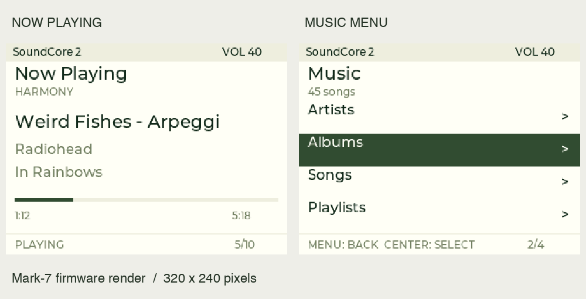

# Mark-7 pocket player preparation

October 9, 2026 · HARMONY-19 · display-only firmware flashed; Dave confirms the test pattern looks correct.

**Second board identified:** the spare Feather is `14:33:5c:98:58:88`, with 8 MB flash. Local configuration now targets this board in display-only mode; the generic defaults still leave identity blank. See the [board record](../../../hardware/mark-7/second-feather-20261004/README.md). Boot confirms 2 MB PSRAM and a passing SRAM test. Display-only bring-up is visually confirmed; Read-only SD mounting and a file sample pass; wheel, battery and full playback tests remain pending.

This is a separate ESP-IDF target for another Adafruit Feather ESP32 V2. Dave owns four identical boards. On October 9 he authorized transferring the ANO assembly from Mark-6 for the first handheld. The Mark-7 target uses Adafruit #4311 in landscape (ST7789, 320 × 240), its microSD slot, the transferred ANO controls, and the #328 2500 mAh battery. The compact UI retains the cream/green palette and uses four menu rows. Bluetooth identifies this target as **Harmony Mark-7**.



## Build and verification

Run from the repository root with the existing pinned toolchain installed:

```sh
bash firmware/mark-7/pocket-player/build.sh build
python3 firmware/mark-7/pocket-player/tests/verify.py
python3 firmware/mark-6/feather-carrier/tests/verify_player_ui.py
```

The script accepts build/configuration actions only and rejects `flash`. The generated sdkconfig and build outputs stay local. Set `CARRIER_EXPECTED_MAC` to the second board's Wi-Fi station MAC during commissioning. Blank or wrong identity prevents application peripheral setup. The known demo board's MAC is rejected even if configured; this runtime guard cannot prevent an external flashing program overwriting that board. Select the second board explicitly before any future flash session.

`CARRIER_DISPLAY_ONLY` runs the ST7789 pattern without storage, controls or Bluetooth. This should be the first powered test. The default player build starts paused; with wheel capture disabled it is preparation for bring-up rather than an operable handheld player.

Host tests exercise the packet decoder; four-row library navigation, playback intents and preference handling; every UI page with long text under address/undefined-behavior sanitizers; and the actual ST7789 transport with SPI mocks. Driver tests cover initialization, landscape bounds, RGB565 byte order, backlight sequencing and bus release on failure, with both standalone and shared bus initialization. Existing Mark-6 UI/audio concurrency tests pass. These tests do not establish physical display orientation, SD compatibility, Bluetooth RF performance or wheel timing.

## Second-board wiring

GPIO numbers below match `components/carrier_board/carrier_pins.h`. Keep Mark-6 assembled. The LCD and SD share SPI2; each has its own chip select. Use the display's 3.3 V-compatible power connection and common ground.

| Signal | Feather GPIO |
| --- | --- |
| LCD/SD SCK | 14 |
| LCD/SD MOSI | 27 |
| SD MISO | 21 |
| SD CS | 25 |
| LCD CS / DC / reset / backlight | 26 / 33 / 32 / 4 |
| Wheel clock / wheel-to-host data | 22 / 20 |
| Wheel CFG / host-to-wheel command | 19 / 5 |
| Wheel BTN1, future RTC wake | 34 (A2) |

The Photo-wheel reference numbers its flex as 1 VCC, 2 clock, 3 CFG, 4 BTN1, 5 unknown/unconnected, 6 wheel-to-host data, 7 host-to-wheel command, 8 ground. Plan 3.3 V power, 10 kOhm pull-ups on clock/data and a 10 kOhm pull-down on BTN1. **Establish how the actual flex maps to adapter pads before connecting power; pad numbering and cable orientation are not yet verified.** GPIO34 has no internal pull resistor. GPIO20 is available on this specific Feather ESP32 V2/PICO board; do not substitute an arbitrary ESP32 pinout.

## Wheel implementation and remaining work

`MARK7_WHEEL_INPUT` is disabled by default. The experimental transport captures the wheel-supplied falling clock edges, assembles 32-bit LSB-first packets after an idle gap, and sends them to the pure decoder. The decoder handles 96-position wraparound, lift/re-touch, discontinuities and button edges. Three position increments produce one scroll step. Center selects, Menu goes back, Play toggles pause, and the side buttons select next/previous tracks. The opening held button is consumed and chords are ignored.

Event mode holds CFG high and the command line idle. The GPIO ISR still needs qualification under Bluetooth playback and flash/NVS activity: missed edges or a full packet queue can lose events. The decoder rejects malformed packets but cannot prove reliable capture. No wheel sleep command, deep sleep, button wake, battery indicator or low-battery policy is implemented. Those remain in the [power design](../../../docs/mark-7-power-and-sleep.md).

Next physical sequence: identify only the spare Feather; test the display pattern; test SD and the player; map the adapter and qualify wheel input; then add and measure sleep/wake. Final case mounts depend on the arriving wheel and flex. See the [pocket fit shell](../../../enclosure/mark-7/pocket-rev-b/README.md).

## Sources and shared code

The ST7789 initialization follows [Adafruit's driver](https://github.com/adafruit/Adafruit-ST7735-Library/blob/master/Adafruit_ST7789.cpp), rotation 1 (MY|MV, RGB), with conservative delays and no offsets for the full 240 × 320 panel. Wheel packet conventions follow [Gigahawk's Photo-wheel research](https://github.com/Gigahawk/clickwheel_reverse_eng). Electrical/timing behavior remains unverified on our hardware.

The target reuses the Mark-6 native library, playback, preferences, Bluetooth and storage implementation. Two compatible shared-source changes allow a configurable row count (Mark-6 remains six) and device name (Mark-6 remains Harmony Mark-6). No Mark-6 firmware or wiring has been replaced.

`MARK7_STORAGE_TEST` selects a read-only SD and shared-display test before Bluetooth bring-up. It takes precedence over display-only mode, lists up to 32 visible entries in each of `/sd` and `/sd/HARMONY`, and reads up to 512 bytes from the first regular file in each directory. It reports mount status on the display. The October 9 test mounted the card and read `HIGHER.MP3` successfully; see [bench evidence](../../../hardware/mark-7/display-bringup-20261009/README.md).

## ANO controls adopted October 9

`MARK7_ANO_INPUT` defaults on and selects the unchanged Mark-6 controls and debounce sources. It excludes experimental Photo-wheel capture. Connect the ANO assembly through the Feather STEMMA QT socket; GPIO2 enables that socket, SDA is GPIO22 and SCL is GPIO20. Display CS remains GPIO26/A0. Rotation stays at Mark-6’s setting of one quarter-turn; verify orientation on the loose assembly. No separate interrupt connection is needed for this polling test. Sleep/wake remains unimplemented.

## October 9 full-library database

The Mac-built `HARMONY/library.hdb` replaces recursive metadata scanning when present. It supports up to 16,384 indexed MP3s with a bounded record cache and PSRAM queues. Use [Harmony Sync](../../../docs/harmony-sync.md) for future card updates; see [database format and preparation](../../../docs/music-database.md). Host tests and native build pass. The image was flashed to the verified spare Feather on October 9; boot reaches the UI with 2 MB PSRAM. SD mounting currently times out, so full-card database tests remain pending. Evidence is in `hardware/mark-7/full-library-20261009/` at the repository root. The legacy 512-track scanner remains for cards without an index.
