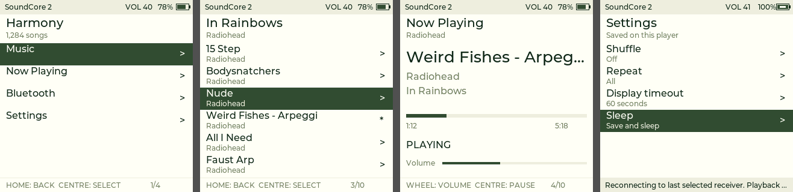
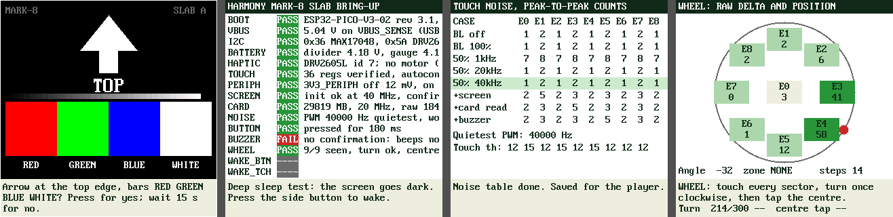

# Harmony Mark-8 slab firmware (revision A)

November 17, 2026. Firmware for the Mark-8 "slab" board in `hardware/mark-8/slab-rev-a/`. **Both projects build and every host test passes. Nothing has been flashed: the board does not exist yet.**

- `slab-bringup/` tests the new board block by block and prints one PASS or FAIL line for each block. It measures the touch noise against the backlight PWM, picks the quietest PWM frequency and saves it, with touch thresholds, for the player.
- `slab-player/` is the Mark-7 player on the slab: the ST7365P at 320 x 320, the touch wheel, buzzer clicks, battery percent, a VSYS-compensated backlight and deep sleep. Bluetooth name **Harmony Mark-8**.

Flash the bring-up first, read its lines, then flash the player. The steps are in "Flash and first power-up" below.




| | Bring-up | Player |
| --- | --- | --- |
| App image | 420,704 bytes | 1,216,208 bytes |
| Factory partition (3 MB) | 87 percent free | 61 percent free |
| ESP-IDF | 5.5, pinned `8c750b08` | same |

## 1. What each project does

The two projects share the drivers in `components/` through `EXTRA_COMPONENT_DIRS`, the way `firmware/mark-7/pocket-player` reuses Mark-6. The player also uses the Mark-6 player core (library, playback, preferences, Bluetooth, UI model) unchanged from the working tree.

| SPEC 9 item | Bring-up block | Player |
| --- | --- | --- |
| I2C scan 0x36, 0x5A, 0x5B | I2C | used |
| Screen colour bars and orientation | SCREEN (bars, TOP arrow, 1 px border, side-button confirm) | ST7365P 320 x 320 RGB565, vendor init |
| Card mount and read speed | CARD (detect, mount at 20 MHz, 4 MB raw read, file read) | library and MP3 on VSPI |
| Wheel raw counts and position | WHEEL (live ring view, 9 electrodes, one turn, centre tap) | scroll steps, four zones and centre |
| Side button | BUTTON | short press play/pause, long press sleep |
| Buzzer | BUZZER (3 beeps, confirm) | click per scroll step and per tap |
| Haptic driver | HAPTIC (detect, ERM setup, buzz if a motor is fitted) | tick on taps if a motor is fitted |
| Battery voltage and percent | BATTERY (divider and MAX17048) | percent in the status bar |
| VBUS | VBUS | backlight cap on USB |
| Peripheral power switch | PERIPH (3V3_PERIPH off and on, measured) | back-power-safe on and off |
| Backlight noise (brief) | NOISE (table, quietest PWM, thresholds, saved) | uses the saved PWM and thresholds |
| Deep sleep and wake | WAKE_BTN, WAKE_TCH | idle and long-press sleep, button and touch wake |

### Shared components

| Component | What it does |
| --- | --- |
| `components/slab_board` | Pin map (`slab_pins.h`), board identity, the back-power-safe 3V3_PERIPH sequence, I2C bus, ADC dividers, backlight PWM and VSYS compensation, buzzer, MAX17048, DRV2605L, NVS calibration, all config options (`Kconfig`) |
| `components/slab_touch` | MPR121 register table and driver, the wheel decoder, the TOUCH_IRQ wheel task |
| `components/st7365p` | ST7365P driver (HSPI, CS held low, DMA from two internal buffers in turn) and the changed-region finder |
| `components/bench_storage` | Mark-8 copy of the Mark-6 read-only card mount, moved to its own VSPI bus |

### Display throughput

A full 320 x 320 frame is 204,811 bytes on the wire, 41 ms at 40 MHz. The player renders into a PSRAM frame, compares it with a copy of what the panel shows, and sends only changed bands (8 rows high, trimmed to the changed columns, runs merged into one window). Pixels go out by DMA from two 6,400-byte internal buffers in turn, so the copy and the transfer overlap. The screen has its own bus, so drawing never waits for the card. Measured on the host with the real renderer (`tests/test_render.c`):

| Update | Bytes | Windows | At 40 MHz |
| --- | --- | --- | --- |
| Scroll step inside the visible rows | 52,374 | 2 | 10.5 ms |
| Scroll step that moves the rows | 46,093 | 7 | 9.2 ms |
| Now playing, one second | 3,659 | 1 | 0.7 ms |
| Volume step | 342 | 2 | 0.1 ms |
| Battery percent change | 1,259 | 1 | 0.3 ms |
| Full frame | 204,811 | 1 | 41.0 ms |

Task order: MP3 decoder 5 (core 1), Bluetooth worker 5, Bluedroid and controller tasks higher, wheel task 6 (short bursts), side button 3, display 1 (core 0). Audio and Bluetooth always preempt the display. The display still waits while the decoder refills its buffer, as on Mark-7, because library reads share the card bus with the MP3 stream.

## 2. Flash and first power-up

### Before power

1. **Battery polarity.** Look at J4: pin 2 is +, and the silkscreen marks + and -. LiPo packs with JST PH plugs come wired both ways. Check the pack against the silkscreen now, but **do not connect the battery for the first power-up.**
2. Put a microSD card with the Harmony music folder in J3 if you have it ready; the CARD block needs one. With a card in the slot the ESP32 ROM boot lines do not print (GPIO15 is the MTDO strap). That is normal; the bootloader and app lines still print.

### Plug USB and find the port

Plug USB-C without the battery. The red charge LED may flicker with no cell; that is normal. On macOS, list the serial ports before and after plugging in:

```sh
ls /dev/cu.*
```

The CH9102F appears as a new `/dev/cu.usbserial-XXXXXXXX` (the Feather V2 with the same chip showed up as `/dev/cu.usbserial-5B1E0643571` on November 7). With WCH's own driver installed it is `/dev/cu.wchusbserial...` instead. Use that path as `<port>` below.

### Source the pinned ESP-IDF and flash the bring-up

`build.sh` only builds; it refuses `flash`. To flash, source the same pinned environment by hand:

```sh
cd ~/projects/Harmony2/firmware
export IDF_PATH="$PWD/upstream/tangara-fw/lib/esp-idf"
export IDF_TOOLS_PATH="$PWD/toolchains/esp-idf"
export PATH="$IDF_TOOLS_PATH/python_env/idf5.5_py3.12_env/bin:$PATH"
. "$IDF_PATH/export.sh"
git -C "$IDF_PATH" rev-parse HEAD     # must print 8c750b088c7cd857d079c0eeb495da199b359461
cd mark-8/slab-bringup
idf.py -p <port> flash monitor
```

The CH9102F and the UMH3N auto-reset put the ESP32 into download mode; you need no buttons. If esptool says "Failed to connect", hold BOOT, tap RESET, release BOOT, and run the command again. `Ctrl-]` leaves the monitor. A new board has blank flash, so nothing needs erasing.

### Expected boot output

```
rst:0x1 (POWERON_RESET),boot:0x13 (SPI_FAST_FLASH_BOOT)      (absent with a card in the slot)
I (..) boot: ESP-IDF 8c750b08 2nd stage bootloader
I (..) boot: chip revision: v3.x                               (v3.0 or v3.1; the image needs v3)
I (..) boot.esp32: SPI Flash Size : 8MB
I (..) boot:  2 factory          factory app      00 00 00010000 00300000
I (..) esp_psram: Found 2MB PSRAM device
I (..) esp_psram: SPI SRAM memory test OK
BRINGUP Harmony Mark-8 slab rev A bring-up mark8-bringup-<rev>, stage 0, wake cause 0
I (..) SLAB: Board: ESP32-PICO-V3-02 rev 3.x, flash 8 MB, PSRAM 2 MB, MAC xx:xx:xx:xx:xx:xx, reset 1; wake cause 0
```

Then the bring-up lines follow, in this order. Each has the form `BRINGUP <BLOCK> <PASS|FAIL|SKIP> <detail>`, and the same list is on the screen once the screen is up. Keep your hands off the wheel until the WHEEL prompt.

### What each line should say, and what a failure most likely means

| Line | PASS looks like | What you do | A FAIL most likely means |
| --- | --- | --- | --- |
| BOOT | `ESP32-PICO-V3-02 rev 3.x, flash 8 MB, PSRAM 2 MB, MAC ...` | nothing | Not a slab module, PSRAM missing, or `CONFIG_SLAB_EXPECTED_MAC` set to another board. The firmware then leaves every output alone. |
| VBUS | `5.0x V on VBUS_SENSE (USB present)` | nothing | R29/R30 missing or wrong. "no USB" means you are on battery only. |
| I2C | `0x36 MAX17048, 0x5A DRV2605L, 0x5B MPR121 (100 kHz)` | nothing | Nothing answers: R31/R32 pull-ups, or a short on SDA/SCL. One part missing: its solder joints (U5 TDFN, U6 QFN-20, U7 MSOP). If 0x5B is missing, U6 ADDR is not tied to VDD and the MPR121 sits on 0x5A with the DRV2605L. |
| BATTERY | `divider 4.2x V, gauge 4.2x V, .. %, v0x001x` | nothing | Divider and gauge differ by more than 0.15 V: R27/R28 or U5. Without a cell the charger output wanders; repeat with the battery fitted. The percent is meaningless without a cell. |
| HAPTIC | `DRV2605L id 7, setup ESP_OK; no motor (config)` | with a motor: feel a buzz | No DRV2605L: U7 joints. Later "motor buzz not confirmed": the M+ and M- joints. |
| TOUCH | `36 regs verified, autoconfig ok, untouched` | hands off | "reset check": U6 not answering right. "autoconfig FAILED": R10 (75k REXT) or an electrode shorted to ground. "out of range": one electrode open or shorted; the `TOUCH data:` line before it shows which (its value sits near 0 or 1023). "touched at start": a hand was on the wheel. |
| PERIPH | `3V3_PERIPH off <400 mV, on >2800 mV (SD_CS pull-up)` | nothing | Off high: Q4 stays on (GPIO13 not driving, R13). On low: Q4 does not switch (R14, C18) or R22 is missing. |
| (screen) | colour bars, white TOP arrow, 1 px white border | look | Backlight but black: FPC not seated or folded wrong (pin 1 at the -Y end), or RST. No backlight: Q5, R17, FPC pins 1, 14, 15. Noise or tearing: lower `CONFIG_SLAB_LCD_SPI_HZ` to 26666666. A missing edge: a RAM offset, set `CONFIG_SLAB_LCD_ROW_OFFSET` or `COL_OFFSET`. |
| CARD | `NNNNN MB, 20 MHz, raw >1000 KB/s, file .. KB/s, 0 err` | card in | "no card": SD_CD switch or R25. "mount failed": card not FAT32, or the long card lines; try `CONFIG_SLAB_SD_SPI_KHZ=10000`. Errors or under 500 KB/s: signal quality at 20 MHz; lower the clock. |
| NOISE | `PWM NNNNN Hz quietest, worst p-p N, touch 12..NN, saved` | hands off about 45 s | A touch threshold above 24 would be needed. The table above it shows which case and which electrode; see "Touch tuning". |
| BUTTON | `pressed for NNN ms` | press the side button once | SW1, R26 or C23, or the button cap binds. |
| SCREEN | `init ok at 40 MHz, picture confirmed` | press again if the arrow points to the top edge (away from the wheel) and the bars read RED GREEN BLUE WHITE | Not confirmed: wrong orientation (`CONFIG_SLAB_LCD_MADCTL`: 0x88 turns it 180 degrees; if the picture then shifts, set `CONFIG_SLAB_LCD_ROW_OFFSET`) or red and blue swapped (toggle 0x08). |
| BUZZER | `3 beeps heard` | press if you heard 3 beeps | Q6, R18, BZ1 or D2. |
| WHEEL | `9/9 seen, turn ok, centre tap ok, peak N.Nx threshold` | touch every sector, turn once clockwise, tap the centre (60 s) | Electrodes missing from "seen": that MPR121 pin or its electrode trace. "peak" under 2.0x: touches too weak for the thresholds (disc not flat on the board, air gap). Turn missing although you turned: set `CONFIG_SLAB_WHEEL_REVERSE`. |
| WAKE_BTN | `woke on side button after N s` | screen goes dark; press the side button | ext0 on GPIO38: SW1 or R26. "no wake in 60 s": the timer woke it instead. |
| WAKE_TCH | `woke on wheel touch after N s` | screen goes dark again; touch and hold the wheel about 1 s | MPR121 slow scan or R11 on TOUCH_IRQ. "TOUCH_IRQ stuck low" in the log: the IRQ line never released. |
| SUMMARY | `BRINGUP SUMMARY PASS 15/15 passed` | | The FAIL list names the blocks to look at. |

The summary boot reprints every line and the noise table, so the end of the log has everything. Press the side button to run the whole test again; RESET does the same.

### Then the battery, then the player

1. Unplug USB. Connect the battery (polarity checked against J4). Plug USB again and press RESET: the bring-up runs again and BATTERY now reads the cell.
2. Flash the player in the same shell:

```sh
cd ../slab-player
idf.py -p <port> flash monitor
```

`idf.py flash` does not erase NVS, so the player finds what the bring-up saved. Expect:

```
I (..) MARK8: Calibration from the bring-up; backlight PWM NNNNN Hz
I (..) ST7365P: 320x320 RGB565, HSPI 40000000 Hz, MADCTL 0x48, offsets 0/0
I (..) POWER: Battery NN % (NNNN mV), USB 1, backlight PWM NNNNN Hz
```

Then the library loads, the screen shows the Harmony menu, and the player is visible to receivers as **Harmony Mark-8**. Playback starts paused, as on Mark-7.

## 3. Using the player

| Control | Action |
| --- | --- |
| Turn the ring | scroll one row per 15 degrees (the first step needs 20); on Now Playing, volume |
| Tap centre | select (on Now Playing: pause and resume) |
| Tap HOME (top) | back one page |
| Hold HOME (0.7 s) | back to the home page |
| Tap next (right) or previous (left) | next or previous track |
| Tap play/pause (bottom) | play or pause |
| Side button, short | play or pause |
| Side button, 1.5 s | deep sleep; the side button or a wheel touch wakes it |

The player also sleeps after 10 minutes without input while nothing plays (`CONFIG_SLAB_IDLE_SLEEP_MIN`), and Settings has a Sleep item. The display timeout from Mark-7 still turns the backlight off.

## 4. Touch tuning

**Read the noise table.** Each row is one condition; each column is one electrode (E0 centre, E1 at 12 o'clock, then clockwise); each number is the peak-to-peak change of the MPR121 filtered data in counts over about 5 s with nothing touching. The last column counts TOUCH_IRQ edges: with hands off, every edge is a false touch.

| Row | Condition | What it isolates |
| --- | --- | --- |
| BL off | backlight off | the floor: the board, the bus and the bring-up's own reads |
| BL 100% | backlight full on, no PWM edges (about 3 s on USB) | LCD_LEDA at a steady level |
| 50% 1kHz, 50% 20kHz, 50% 40kHz | backlight PWM at 50 percent duty | LCD_LEDA swinging about 1.5 V behind the wheel |
| +screen | quietest PWM, plus the screen redrawing nonstop | LCD_DC (23 mm behind the electrodes) |
| +card read | quietest PWM, plus nonstop card reads | SD_CS (12.8 mm, 10 vias) |
| +buzzer | quietest PWM, plus a 4 kHz tone | BZ_GATE (4 mm) |

The quietest PWM row is the one with the lowest worst electrode, then the lowest sum, then the higher frequency. It is highlighted, saved in NVS and used by the player.

**Thresholds.** Following hardware README touch item 5, each electrode's touch threshold is 3 times the worst peak-to-peak seen in the quietest PWM row and the three activity rows, and never below 12. Release is half of it. NOISE fails if any electrode would need more than 24. The WHEEL block then checks the real margin: the strongest touch on each electrode must be at least 2 times its threshold.

**Reading the serial log.** The `NOISE <case> E0=.. .. worst=.. irqs=..` lines are the table. `WHEEL t=.. touched=0x.. delta ..` lines show each read during the wheel test: delta is baseline minus filtered, so a touch is a large positive number on the touched sectors.

**If the numbers are bad:**

- One electrode noisy in one row: that row's line runs behind it. Raise only that electrode's threshold, which the bring-up already did.
- Every PWM row noisy, BL 100% quiet: the backlight edges couple in. Try the other frequencies with `CONFIG_SLAB_BL_PWM_HZ`; the player reads it before the saved value.
- IRQ count above 0 with hands off: false touches. Raise the thresholds with `CONFIG_SLAB_TOUCH_USE_SAVED` off and `CONFIG_SLAB_TOUCH_THRESHOLD` and `CONFIG_SLAB_RELEASE_THRESHOLD` set by hand.
- Long holds drop out (HOME hold fails): set `CONFIG_SLAB_TOUCH_SLOW_FALLING_BASELINE`, the bench filter v2 from November 7.
- Scrolling feels steppy: the wheel position updates only when the touch status changes (about 16 times per turn, see Decisions 4). If the noise table is clean, try `CONFIG_SLAB_WHEEL_TRACKING_READS`, then repeat the bring-up and compare the noise.

Change options with `bash build.sh menuconfig` in either project ("Harmony Mark-8 slab board").

## 5. Decisions I made

1. **Two projects with shared components**, not one project with two configurations. The bring-up has no Bluetooth and needs different sdkconfig values; separate projects keep two small, separate images and two `build.sh` scripts, and still share every driver through `components/`. Both use the same partition table, so the player reads the calibration the bring-up writes to NVS.
2. **Chip revision 3 minimum** (`CONFIG_ESP32_REV_MIN_3`). The ESP32-PICO-V3-02 is an ECO V3 chip (the Feather with the same module reports v3.1). It drops the PSRAM cache workaround; without it the player overflowed IRAM by 316 bytes.
3. **Screen at 40 MHz, half duplex, write only.** The DLC sheet gives a 66 ns minimum write cycle (15 MHz); 40 MHz is common practice for this controller family and is a config value. IDF refuses full duplex above about 26.7 MHz on these GPIO-matrix pins, so the device is half duplex. COLMOD is 0x55 (RGB565) where the vendor writes 0x77; everything else follows the vendor file, including MADCTL 0x48 and inversion on. Column and row offsets are config values, default 0.
4. **The MPR121 is read only after TOUCH_IRQ falls** (README touch rule 3, exactly). The IRQ fires only when a touch status changes, so the position updates about 16 times per turn in the host model, not every 16 ms scan. The step is 15 degrees (20 for the first step of a touch), so a turn gives 23 steps. `CONFIG_SLAB_WHEEL_TRACKING_READS` (off) adds reads in the middle of each scan gap, timed from the last IRQ, for 6 scans; it is there to try once the noise is known.
5. **After the first autoconfig**, the firmware writes 0x7B = 0x8A (autoconfig off) and resumes with ECR 0x09 (keep baselines). The start itself follows README item 4 exactly (0x7B = 0x8B, ECR 0x89). This lets the firmware stop the MPR121 to change thresholds or to read the gauge without new autoconfig runs or baseline jumps.
6. **Other I2C traffic in quiet slots.** The fuel gauge read and haptic writes run right after an MPR121 read. If the wheel stays idle for 5 minutes, the gauge read runs with the MPR121 stopped; the 3-byte stop command itself is the only I2C transfer that is not timed to a scan.
7. **Noise measurement by spaced polling.** The bring-up reads every 208 ms, which is (2 x SFI + 1) x ESI. The filters then never contain a scan that one of its own reads disturbed. The README asks for a noise log with nothing touching, when no IRQ fires, so this is the one place that polls. It also counts IRQ edges as false touches.
8. **The 100 percent backlight case lasts about 3 s on USB** (12 samples) instead of 5. README Power note 3 keeps the duty at or below 80 percent on USB for R17; the brief asks for a no-edges case. 0.27 W for 3 s is inside the short-time overload rating of a 1206 thick-film resistor.
9. **Zone mapping.** HOME tap is BACK (Mark-7's Menu), HOME hold is back to the root (seven BACKs), centre is SELECT, left is previous, right is next, bottom is play/pause. Each zone is 40 degrees each side of its label, so taps at the diagonals do nothing. The side button plays and pauses on a short press and sleeps on a 1.5 s press. The Mark-6 UI code is unchanged.
10. **Tap and hold.** A tap is at most 400 ms and 12 degrees of movement with no scroll step; 700 ms still is a hold. A touch that moves is never a tap or a hold.
11. **Clicks.** 4 kHz, 50 percent, 1.5 ms per scroll step (up to three per read, 4 ms apart) and 5 ms per tap, started right after the read so they end before the next scan.
12. **Backlight model.** LED current = (VSYS - 2.8 V) / 11.5 ohm, which gives 122 mA at 4.2 V and 165 mA at 4.7 V (README: about 120 and 170). Brightness 100 percent is the full current at a 3.7 V cell (78 mA); the default is 80 percent (62 mA). Duty = target / current, capped at 80 percent on USB and at 231 mW in R17. VSYS comes from the two ADC dividers.
13. **Battery percent** from the MAX17048 every 30 s (rounded, clamped to 100). The gauge is forced into hibernate in deep sleep and restored at boot.
14. **Deep sleep**: touch wake on by default, with the MPR121 scanning every 64 ms in sleep. The board identity check accepts any slab board (package, 8 MB flash, 2 MB PSRAM); `CONFIG_SLAB_EXPECTED_MAC` can lock it to one board, as Mark-7 did.
15. **Bring-up confirmations use the side button.** The screen picture, the beeps and an optional motor buzz need a person; the side button is tested first so it can answer.
16. **3V3_PERIPH is measured through R22.** With Q4 off, SD_CS drains the rail through R22, then ADC2 on GPIO25 reads the rail through the same pull-up, off and on.
17. **Player layout.** Six list rows (Mark-6's count), a larger now-playing page with a volume bar, the battery percent and icon in the status bar, wheel hints in the footer. Same palette and fonts as Mark-7.
18. **I2C at 100 kHz.** 4.7k pull-ups with three parts may be outside the 400 kHz rise-time limit. A full wheel read (39 bytes) then takes about 4 ms of the 15 ms gap. It is a config value.
19. **After a touch wake** the firmware waits, by IRQ edges, until the finger is off before it restarts the MPR121, so the new baselines are untouched ones.
20. **Card clock range** stops at 26,666 kHz: above that IDF refuses full-duplex SPI on these pins.

## 6. Open risks

- **Screen**: 40 MHz is above the module sheet's write timing. Orientation, colour order and RAM offsets are set from the vendor code and are not seen on a real panel yet. The bring-up shows each of them.
- **Touch noise is unknown until the board exists.** Seven switching nets run on L3 behind the electrodes (README "Touch-wheel re-route"). LCD_DC, SD_CS and BZ_GATE switch without regard to the scans; the noise table measures each one. I2C and the clicks are timed to the gaps.
- **Scroll feel** with IRQ-only reads (about 16 updates per turn) is not tested by hand.
- **Baselines after start** come from the 5 high bits of the data (CL = BVA = 10, as the README asks), so a baseline can start up to 31 counts low and the slow rising filter takes some seconds to settle. Touches right after boot may feel weaker.
- **Sleep current is estimated, not measured.** MPR121: about 3 uA stopped; at a 64 ms scan about 10 uA (6 to 25 uA, scaled from the datasheet's 29 uA at 16 ms; FFI 18 raises it). Board total from the hardware README: 30 to 50 uA with the MPR121 stopped, plus the slow scan, plus 33 uA through R25 whenever a card is in the slot. ext0 keeps the RTC peripherals powered (a few uA). Measure it on battery with a meter in series.
- **Card at 20 MHz** over 77 to 88 mm traces is not tested.
- **Audio dropouts while scrolling**: the screen no longer shares a bus with the card, but library reads still share the card with the MP3 stream. The refill wait from Mark-7 is kept. Not measured with Bluetooth.
- **Backlight model** is fitted to the two README points; LED forward voltage varies.
- **DRV2605L** runs the ERM in open loop with the chip's default drive voltage (about 3 V). No auto-calibration.
- **VBUS reading** sits near the top of the ADC range (5.25 V gives 3.15 V at the pin).

## 7. Uncommitted dependencies

The player compiles these Mark-6 files from the working tree. They hold uncommitted changes from October 9 (the version flashed on Dave's Mark-7). **Commit them before the Mark-8 build is reproducible from git.**

- `firmware/mark-6/feather-carrier/main/album.c`, `album.h`
- `firmware/mark-6/feather-carrier/main/audio_player.c`, `audio_player.h`
- `firmware/mark-6/feather-carrier/main/player_bluetooth.c`, `player_bluetooth.h`
- `firmware/mark-6/feather-carrier/main/player_prefs.c`, `player_prefs.h`
- `firmware/mark-6/feather-carrier/main/player_ui.c`, `player_ui.h`

The other Mark-6 files used (`album_metadata.*`, `playback.*`, `player_display.h`, `ui_assets/fonts.h`, `ui_assets/trial_durations.h`, `components/bench_mp3`, `components/minimp3`, `components/bench_display/font8x16.h`) are committed and unchanged.

These Mark-8 files are copies of working-tree files, changed for the slab; they do not depend on the originals at build time, but the originals are where they came from: `firmware/mark-7/pocket-player/main/main.c`, `player_display.c`, `ui_render.c` (uncommitted changes) and `player_power.c` (untracked, never committed), and `firmware/mark-6/feather-player-bench/components/bench_storage/bench_storage.c` (committed). All of `firmware/mark-8/` except `mpr121-bench/` is new and uncommitted. `verification.json` lists the same files with SHA-256 hashes.

## 8. Build and test

```sh
bash firmware/mark-8/slab-bringup/build.sh build
bash firmware/mark-8/slab-player/build.sh build
python3 firmware/mark-8/tests/verify.py
```

`build.sh` accepts build, size, menuconfig, reconfigure and fullclean, and refuses `flash` (exit 2), like Mark-7's. `verify.py` compiles seven host test programs with address and undefined-behaviour sanitizers and runs eight cross-checks:

| Check | Against |
| --- | --- |
| Pin map, I2C addresses, divider ratios | hardware README "ESP32 pin map", SPEC 5.1 and 5.3 |
| Wheel electrode angles and tap zones | `design.py` SECTOR_ANGLES and the E1 mapping, README sector centroids, SPEC 4 labels, enclosure `params.py` label circle |
| Wheel decoder | angles, wraparound and the +-180 seam, 23 steps per turn either way, coarse reads, reverse, glitches, taps on four zones and the dead bands, centre tap, holds |
| MPR121 register setup | README "Firmware for the touch wheel" items 4 and 5, parsed from the text |
| Touch rules in the source | CS only low, no TE, MPR121 reads only in the IRQ task (and the bring-up noise table) |
| ST7365P init | `reference/DLC-T2.7DDS1-initial-code.txt`, command by command, with the one RGB565 change; driver against SPI mocks (no CS pin, DC only for commands, DMA ping-pong, byte order, bounds, offsets) |
| Back-power-safe sequence | GPIO mocks: lines low or input at every switch of GPIO13, nothing driven high into the dead rail, failures stop early |
| VSYS backlight, battery parsing | README currents, USB and R17 caps over a sweep; MAX17048 VCELL, SOC, CRATE, version |
| Controls | through the real Mark-6 `player_ui.c` |
| Previews | `preview/*.png`, 320 x 320, both projects |

The host tests do not establish anything about the real panel, card, touch feel, RF or current.

## 9. Files

| Path | What it is |
| --- | --- |
| `README.md` | this file |
| `verification.json` | build sizes and hashes, host test results, display costs, dependencies, source hashes (written by `verify.py`) |
| `components/slab_board/` | `slab_pins.h`, `slab_board.c` (identity, idle state, sleep holds), `slab_power_seq.c` (3V3_PERIPH order), `slab_i2c.c`, `slab_analog*.c`, `slab_backlight*.c`, `slab_buzzer.c`, `max17048*.c`, `drv2605.c`, `slab_cal.c`, `Kconfig` (every option) |
| `components/slab_touch/` | `mpr121_regs.c` (table and parsing), `mpr121.c` (driver), `wheel.c` (decoder), `slab_wheel.c` (IRQ task, quiet-slot work) |
| `components/st7365p/` | `st7365p_init.h` (vendor init), `st7365p.c` (driver), `slab_dirty.c` (changed regions) |
| `components/bench_storage/` | Mark-8 copy of the read-only card mount (VSPI) |
| `slab-bringup/` | `build.sh`, `CMakeLists.txt`, `sdkconfig.defaults`, `partitions.csv`; `main/bringup.c` (the test), `bringup_ui.c` and `gfx.c` (pages), `noise_stats.c` |
| `slab-player/` | `build.sh`, `CMakeLists.txt`, `sdkconfig.defaults`, `partitions.csv`; `main/main.c`, `player_display.c`, `player_power.c`, `slab_render.c`, `slab_controls.c`, `controls_map.c` |
| `tests/` | `verify.py`, the seven `test_*.c` programs, `mock/` (ESP-IDF stand-ins) |
| `preview/` | `slab-ui.png`, `bringup-ui.png` and one PNG per page |
| `mpr121-bench/` | the November 7 MPR121 bench firmware (unchanged) |
