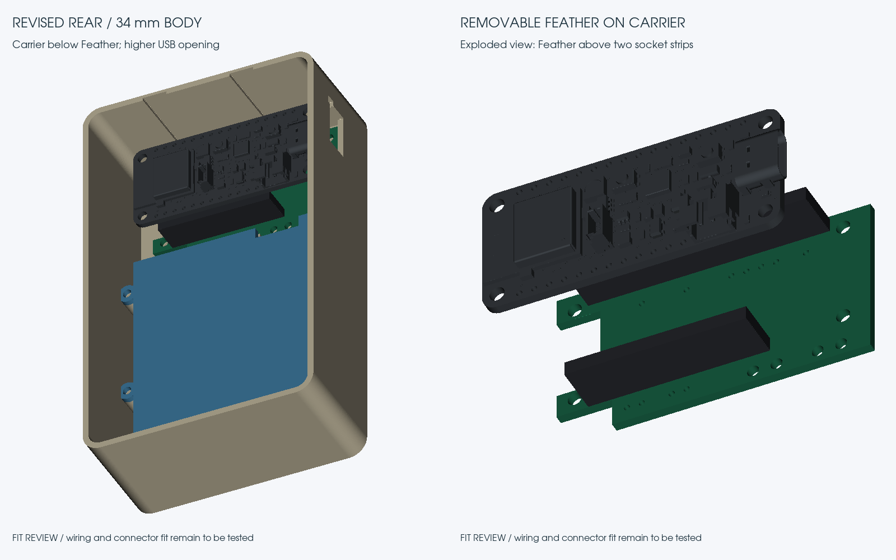

# Mark-7 removable Feather carrier, revision A

The first carrier design is ready for an unpowered fit review. It replaces the Feather's loose jumper connections with sockets and labeled solder pads. Dave adopted this direction on October 11, 2026. Build Mark-7 portable Bluetooth player (HARMONY-19) tracks physical acceptance.

The existing Feather, faceplate components, firmware, battery connector, and ANO cable remain in use. The carrier is a passive two-layer PCB, nominally 53.5 × 28.3 × 1.6 mm. The PCBWay Gerber package is prepared for quotation. Physical fit remains pending; no fabrication has been released. See [submission details](pcbway/README.md).

## What connects where

The Feather plugs into two female socket strips. Ten wires run between the carrier and the display/SD board. Those wires require soldering at their endpoints. The carrier removes the need to solder onto the Feather's male pins.

The ANO STEMMA QT cable connects directly to the Feather. The battery connects directly to its JST socket. P11 and R1 reserve optional ANO interrupt wiring. Leave both unused for the current cable-only sleep behavior.

| Pad | Display label / function | Feather connection |
| --- | --- | --- |
| P1 | VIN | 3V3, JP1 pin 15 |
| P2 | GND | GND, JP1 pin 13 |
| P3 | TFT CS | GPIO26, JP1 pin 12 |
| P4 | SD CS | GPIO25, JP1 pin 11 |
| P5 | LITE | GPIO4, JP1 pin 7 |
| P6 | MISO | GPIO21, JP1 pin 4 |
| P7 | MOSI | GPIO27, JP3 pin 6 |
| P8 | DC | GPIO33, JP3 pin 7 |
| P9 | RST | GPIO32, JP3 pin 9 |
| P10 | SCK | GPIO14, JP3 pin 10 |
| P11 | Optional ANO INT | GPIO34, JP1 pin 10 |

Display VIN receives Feather 3V3. The display's separate 3Vo pin stays disconnected. Display reset does not connect to Feather RESET. Firmware uses GPIO14 and GPIO27 for clock and MOSI, rather than the Feather's default SPI pins.

R1 accepts an optional 10k axial resistor between 3V3 and ANO INT. Installing it does not enable interrupt wake in firmware. The optional wake setting and physical INT lead are separate requirements.

## Mechanical changes

The modeled assembly retains the accepted 64 × 105 × 34 mm body. A revised rear tray lowers the carrier supports and raises the USB opening by 6.45 mm. The existing printed rear tray cannot directly accept this stack.

Four M2 × 6 mm self-tapping screws secure the carrier. Each screw uses a 2 mm printed spacer under its head. Nominal thread engagement is 2.4 mm. The Feather stays removable and is held by the socket contacts; retention still needs physical testing.

The selected sockets are Samtec SSW-116-01-G-S and SSW-112-01-G-S. Their body height is 8.51 mm. The model assumes a 2.54 mm plastic body on the existing male headers. These are specific socket dimensions, not a promise that any female header will fit.

Socket tails leave only 0.66 mm nominal clearance above the tray floor before solder fillets. Check actual solder height before final assembly. Wire bends, QT/JST plugs, and removal access also need a physical check.

The carrier has a cutout beneath the vendor antenna rectangle. It does not provide a full RF clearance zone. Closed-case Bluetooth range remains unqualified.

## Print and test the small fit kit first

Open [mark7-carrier-fit-kit.3mf](print/mark7-carrier-fit-kit.3mf) as geometry in the slicer. It contains eight separate objects on a 118.5 × 50.41 mm area. The file is unsliced and contains no printer settings. Use the established PLA profile; consider a brim for the narrow socket stand-ins.

| Part | Quantity | Purpose |
| --- | --- | --- |
| Mount test base | 1 | Tests the four short supports and screw engagement |
| Carrier dummy | 1 | Matches the PCB outline, thickness, and holes |
| Long socket stand-in | 1 | Represents the 16-position socket, 8.51 mm high |
| Short socket stand-in | 1 | Represents the 12-position socket, 8.51 mm high |
| Screw spacer | 4 | Adds 2 mm under each M2 × 6 screw head |

1. Use the spare Feather first. Disconnect USB and the battery.
2. Place the carrier dummy over the four supports on the test base.
3. Put one printed spacer under each M2 × 6 screw head.
4. Start all four screws, then tighten gently. Stop if a support splits or the screw bottoms out.
5. Place the long socket stand-in over the 16-hole row and the short one over the 12-hole row.
6. Align the Feather's headers with the stand-ins. Its USB socket faces the short, unnotched end of the carrier.
7. Lower the Feather gently. Do not force pins through undersized printed holes.
8. Check that the existing black header bodies rest on the socket stand-ins without bending the Feather.
9. Check that the carrier stays flat and the screws hold without protruding through the base.
10. Report any rocking, pin mismatch, blocked USB access, or interference with the screw heads.

The printed stand-ins have clearance holes, not electrical contacts. They test spacing and stack height only. Real sockets require 3.68–6.35 mm pin insertion; confirm exposed pin length before purchase. The printed test cannot qualify contact force or electrical reliability.

After this test, review the revised rear tray with the actual cable routing. Keep the working faceplate wiring intact until the physical fit is accepted. Ten suitable insulated wires will still be needed; wire stock has not been confirmed.

## Evidence and limits

- KiCad 8.0.9: zero ERC violations, zero DRC violations, and zero unconnected nets.
- Independent check: all 28 socket positions match the vendor header layout.
- Independent check: all connected PCB pads match the exported schematic netlist.
- Independent check: eight display/SD GPIO routes match the current firmware.
- Mechanical checks: 168 modeled comparisons report no collisions above the configured tolerance.
- Print checks: eight watertight single-body objects, no overlap, and a successful 3MF round trip.

These checks do not prove solderability, signal integrity, power margin, RF range, or physical fit. Socket bodies and plugs use nominal envelopes. The previously reported cracked faceplate support is not qualified by this work.

## Files and rebuilding

- `harmony-mark7-carrier.kicad_pro`, `.kicad_sch`, `.kicad_pcb`: editable KiCad project.
- `Harmony.pretty`, `Harmony.kicad_sym`: local component libraries.
- `review/schematic.pdf`: readable electrical drawing.
- `mechanical/assembly.step`: assembly model; `mechanical/tray.stl` is a candidate rear revision.
- `bom.csv`, `connections.json`: parts and pin assignments.
- `verification.json`, `mechanical/validation.json`, `print/validation.json`: check results.

Run `rebuild.sh` from this directory to rebuild the electrical files and fit kit. It uses the repository's KiCad 8.0.9 runtime and `uv`. Mechanical generation can take several minutes. Preview PNGs use the optional rendering commands in that script.

## Sources and cross-references

- [Adafruit Feather ESP32 V2 source CAD](https://github.com/adafruit/Adafruit-ESP32-Feather-V2-PCB), retained under `hardware/mark-6/carrier-rev-a/reference/`.
- [Feather pinouts](https://learn.adafruit.com/adafruit-esp32-feather-v2/pinouts).
- [Display pinouts](https://learn.adafruit.com/2-0-inch-320-x-240-color-ips-tft-display/pinouts).
- [Samtec SSW drawing](https://suddendocs.samtec.com/catalog_english/ssw_th.pdf): socket dimensions and insertion limits. Stock and pricing are not verified.
- [Mark-7 scope](../../../docs/mark-7-portable-scope.md).
- [Power and sleep](../../../docs/mark-7-power-and-sleep.md).
- [Previous rear design](../../../enclosure/mark-7/rear-review-c/README.md).
