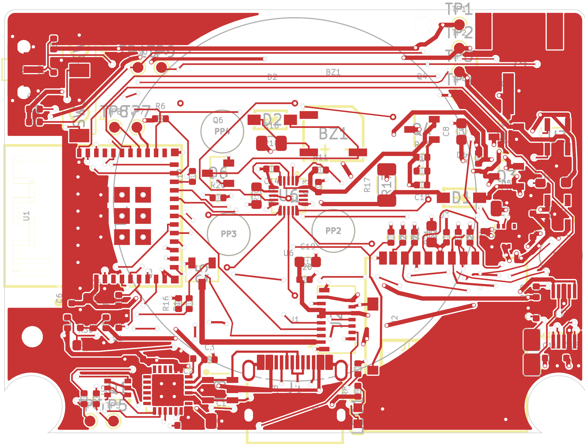

# Harmony Mark-8 "slab" board, revision A

This is the main board of the Mark-8 slab music player, built from `SPEC.md`. It is a 4-layer, 0.8 mm board of 54.4 x 39.6 mm. Every part is on one side and JLCPCB places all of them. When the boards arrive, Dave only flashes them, then adds the screen, the battery and the printed case. No soldering is needed, except for the optional vibration motor (two joints).

**Status: ready to order, with accepted exceptions.** ERC 0 errors, 0 warnings; DRC 0 errors, 0 unconnected, 32 silkscreen warnings; `verify.py` passes. The board comes from step C of the touch-wheel re-route: it keeps the checked routing from before the touch review. Seven slow switching nets keep their L3 track behind the touch electrodes, and the two main VBUS paths keep a 0.2 mm bottleneck. Both are accepted exceptions with caps in `design.py`, and the firmware must follow "Firmware for the touch wheel" (see "Touch-wheel re-route"). Nothing has been uploaded or ordered.



## What is on the board

```
USB-C J1 ──ESD U8──┬─ D+/D- ── CH9102F U2 ── TXD/RXD (1k) ── ESP32 U1 (UART0)
                   │                   └─ DTR/RTS ── UMH3N Q1 ── EN / IO0
                   ├─ VBUS ── B5819W D1 ───────────────┐
                   ├─ VBUS ── MCP73831 U3 ── VBAT ──────┤
                   └─ CC1/CC2 5.1k to GND              │
JST PH J4 ── AO3401A Q2 (reverse battery) ── VBAT ── AO3401A Q3 (off while VBUS) ── VSYS
                                               │                                    │
                                     MAX17048 U5 (I2C 0x36)      RT9080 U4 ── 3V3 ──┼── ESP32 U1, MPR121 U6, MAX17048 U5 logic
                                                                                    │      └─ AO3401A Q4 ── 3V3_PERIPH ── screen J2, microSD J3
                                                    VSYS ── 10R ── screen LEDA; LEDK ── AO3400A Q5 ── GND (IO4 PWM)
                                                    VSYS ── 33R ── buzzer BZ1 ── AO3400A Q6 (IO2)
                                                    VSYS ── DRV2605L U7 (I2C 0x5A) ── motor pads M+ M-
ESP32 HSPI (14/27/26/33/32, TE 39) ── FH35C J2 (screen)      ESP32 VSPI (5/19/21/25, CD 15) ── DM3AT J3 (microSD)
ESP32 I2C (22/20) ── U5 0x36, U6 0x5B, U7 0x5A               MPR121 U6 ── 9 electrodes on L4 (E1)
```

| Ref | Part | LCSC |
| --- | --- | --- |
| U1 | ESP32-PICO-MINI-02-N8R2 | C2980306 |
| U2 | CH9102F USB to serial | C2858418 |
| U3 | MCP73831T-2ACI/OT charger, PROG 2.7k (about 370 mA) | C424093 |
| U4 | RT9080-33GJ5 3.3 V regulator | C841192 |
| U5 | MAX17048G+T10 fuel gauge | C2682616 |
| U6 | MPR121QR2 touch controller | C91322 |
| U7 | DRV2605LDGSR haptic driver | C527464 |
| U8 | USBLC6-2SC6 USB ESD | C7519 |
| J1 | HRO TYPE-C-31-M-12 USB-C | C165948 |
| J2 | Hirose FH35C-15S-0.3SHW(50) screen FPC | C2889267 |
| J3 | Hirose DM3AT-SF-PEJM5 microSD | C114218 |
| J4 | XYECONN XY-S2B-PH-SM4-TB (JST PH 2.0 side entry) | C54582899 |
| SW1 | Alps SKRTLAE010 side button | C110293 |
| SW2, SW3 | TS-1088-AR02016 BOOT, RESET | C720477 |
| BZ1 | MLT-5020 magnetic buzzer | C94598 |
| Q1 | UMH3N auto-reset | C62892 |
| Q2, Q3, Q4 | AO3401A | C15127 |
| Q5, Q6 | AO3400A | C20917 |
| D1, D2 | B5819W SL | C8598 |
| LED1 | KT-0603R red | C2286 |

The full BOM (39 lines) is `jlcpcb/bom.csv`; the netlist is `netlist.xml`; the schematic is `harmony-mark8-slab.kicad_sch` and `review/schematic.pdf`.

## ESP32 pin map

| GPIO | Module pin | Net | Connects to |
| --- | --- | --- | --- |
| EN | 8 | ESP_EN | 10k to 3V3 (R5), 1 uF (C4), RESET SW3, Q1 |
| 0 | 23 | BOOT | 10k to 3V3 (R6), BOOT SW2, Q1 |
| 1 TXD0 | 31 | U0TXD | 1k R3 to U2 RXD; test pad TP5 |
| 3 RXD0 | 30 | U0RXD | 1k R4 from U2 TXD; test pad TP6 |
| 14 | 18 | LCD_SCK | J2 pin 5 SCLK |
| 27 | 17 | LCD_MOSI | J2 pin 4 SDA |
| 26 | 16 | LCD_CS | J2 pin 7 |
| 33 | 13 | LCD_DC | J2 pin 6 RS |
| 32 | 12 | LCD_RST | J2 pin 8 |
| 4 | 24 | LCD_BL | 100R R15 to Q5 gate, 100k R16 pull-down |
| 39 | 7 | LCD_TE | J2 pin 3 FMARK |
| 5 | 29 | SD_SCK | J3 pin 5 CLK |
| 19 | 33 | SD_MOSI | J3 pin 3 CMD |
| 21 | 35 | SD_MISO | J3 pin 7 DAT0, 10k R21 to 3V3_PERIPH |
| 25 | 15 | SD_CS | J3 pin 2 DAT3, 10k R22 to 3V3_PERIPH |
| 15 | 21 | SD_CD | J3 card-detect switch to GND, 100k R25 to 3V3 |
| 22 | 34 | I2C_SDA | 4.7k R31; U5, U6, U7; test pad TP9 |
| 20 | 26 | I2C_SCL | 4.7k R32; U5, U6, U7; test pad TP10 |
| 34 | 9 | TOUCH_IRQ | U6 IRQ, 10k R11 |
| 38 | 6 | SIDE_BTN | SW1 to GND, 100k R26, 100 nF C23 |
| 13 | 20 | PERIPH_EN_N | 10k R14 into Q4 gate (100k R13 up, 100 nF C18 gate to source) |
| 2 | 22 | BUZZER | 100R R19 to Q6 gate, 100k R20 pull-down |
| 35 | 10 | VBAT_SENSE | VBAT through 1M R27 / 1M R28, 100 nF C24 |
| 36 | 4 | VBUS_SENSE | VBUS through 100k R29 / 150k R30 |
| 7, 8 | 27, 28 | GPIO7, GPIO8 | test pads TP7, TP8 |
| 12, 37 | 19, 5 | not connected | IO12 is the MTDI strap |

SD DAT1 and DAT2 have 10k pull-ups (R23, R24) to 3V3_PERIPH. J4: pin 2 is battery +, pin 1 is battery -, marked + and - on the silkscreen.

## Power

- USB VBUS feeds the charger U3, the CH9102F U2 (VDD5 and its VBUS sense) and, through D1, VSYS. C1 10 uF at J1, C7 4.7 uF at U3, C25 100 nF at U2.
- The battery connects through Q2 (P-MOSFET, drain on the J4 + pin, source on VBAT, gate on GND) to VBAT, which has C8 10 uF. Q3 (drain VBAT, source VSYS, gate on VBUS with R9 100k to GND) connects VBAT to VSYS while VBUS is absent.
- VSYS (C9 22 uF) feeds U4 (RT9080, EN on VSYS, C10 1 uF in, C11 1 uF out), the 10 R backlight resistor R17, the 33 R buzzer resistor R18 and U7.
- 3V3 feeds U1 (C5 22 uF + C6 100 nF at pin 3), U5 logic side through the I2C pull-ups, U6, the I2C and button pull-ups, U2 VIO and Q4.
- Q4 switches 3V3 to 3V3_PERIPH (screen VCC and IOVCC, microSD VDD, the SD pull-ups). GPIO13 low turns it on; R13 holds it off at reset; R14 10k with C18 100 nF from gate to source gives about a 1 ms turn-on ramp so the 20 uF behind it does not pull 3V3 down. C19 10 uF + C20 100 nF at J2, C21 10 uF + C22 100 nF at J3.
- U2 CH9102F: VDD5 and VBUS from USB VBUS, V3 decoupled by C2, VIO on 3V3 with C3. This is WCH's dual-supply scheme: on battery VDD5 is at 0 V, VIO draws about 2 uA and the chip does not back-feed (CH9102 datasheet 5.2).
- Deep-sleep estimate with Q4 off, U2 unpowered, U6 in stop mode, U7 in standby: ESP32-PICO-MINI-02 about 10 uA, U5 3 to 23 uA (hibernate or active), U6 about 3 uA, U7 about 4 uA, U4 2 uA, VBAT divider 2.1 uA, U3 reverse current under 2 uA: about 30 to 50 uA. With a card in J3, the card-detect switch also draws 33 uA through R25 (3.3 V / 100k). All are under the 100 uA target.

Firmware notes that follow from the hardware:
1. Drive every screen and card line low, or make it an input, before setting GPIO13 high (Q4 off), or the ESP32 back-powers the screen and card through their input protection (SPEC 5.3).
2. Touch wake needs the MPR121 running (a slow scan), not stop mode. The 100 uA budget above assumes stop mode; measure the run-mode current before relying on touch wake.
3. The backlight runs from VSYS through 10 R: about 120 mA at 4.2 V battery and about 170 mA on USB (VSYS 4.7 V) at 100 percent duty. R17 is a 1206 rated 0.25 W; keep the duty cycle at or below 80 percent on USB (SPEC 9 asks firmware to compensate for VSYS anyway).
4. GPIO15 (SD_CD) is the MTDO strap: a card in the slot silences the ROM boot log. GPIO2 (BUZZER) has R20 100k to GND, so the strap stays low at boot.
5. The microSD lines go around the touch wheel, so they are long: SD_MOSI 88 mm, SD_SCK 82 mm, SD_MISO 77 mm, SD_CS 33 mm (the screen lines are 17 to 45 mm). Start the card at 20 MHz SPI and raise the clock only after reads at that speed are clean.

## Layout

The board sits behind the wheel, touch side (L4) against the front skin, component side toward the back plate. KiCad shows the component side, so left and right are swapped against the device front view. Every position in this README and in `mechanical-interface.json` is in device coordinates (SPEC 1); `design.py` holds the transform (`to_kicad`, `to_device`).

| Area (device) | What is there |
| --- | --- |
| Top left | J4 battery connector (cable to +Y), Q2, charger U3, Q3, D1, regulator U4, fuel gauge U5, bulk caps |
| Left edge, lower | haptic driver U7 and motor pads M+ M- |
| Right edge | U1 with its antenna end flush with x = +27.2; SW1 side button above it, actuator through the right wall |
| Top right | BOOT SW2, RESET SW3, side-button RC, I2C pull-ups |
| Behind the wheel centre | MPR121 U6 with its parts, buzzer BZ1 and its driver, the J2 decoupling |
| Right of centre, just above the ramp zone | backlight switch Q5 (its body ends 0.05 above the ramp zone); its gate resistors R15 and R16 sit in the ramp zone (0402, 0.35 tall, under the 0.6 limit) |
| Bottom centre | USB-C J1 (mating face y = -50.4), screen connector J2 just above it (slot toward +X, into the empty ramp) |
| Bottom left | microSD J3 (card enters from -Y), its pull-ups in one row above the contacts, charge LED1 between J3 and J1 |
| Bottom right | ESD U8, CH9102F U2, auto-reset Q1, CC resistors, VBUS and VBAT sense dividers, EN RC |

### Touch wheel

- L4 carries nine copper zones: a centre disc r <= 7.0 and eight ring sectors from r 7.8 to 16.6, each boundary a three-tooth sawtooth (0.9 mm tangential half-amplitude) offset 0.2 each side, so neighbours are exactly 0.4 apart (checked by `verify.py`). ELE1 is at 12 o'clock seen from the front, then clockwise (`wheel.py`). Each electrode connects through one plated pad of E1 to an MPR121 pin, by an L1 track where one fits and otherwise partly on L3.
- L2 under the wheel is a 25 percent GND hatch (0.2 mm lines, 1.3 mm gaps, 45 degrees) out to r 17.6. The L4 GND pour and the L1 GND pour stop at r 17.6.
- L3 lies about 0.1 mm behind the L4 electrodes, with no ground between them. A track there couples into the electrode above it (about 0.5 pF per 10 mm of 0.15 mm track), and one edge during an MPR121 charge window can shift a reading by about as much as a touch (NXP AN3863: keep other signals on the far side of the ground layer). So inside the electrode disc plus 0.5 mm (r <= 17.1, `WHEEL_KEEPOUT_R`) only DC and static nets and the electrode lines may run on L3 or place vias: 3V3, 3V3_PERIPH, VBUS, VSYS, VBAT, BAT_P, LCD_LEDA, LCD_RST, PERIPH_EN_N, PERIPH_GATE, SD_CD, SIDE_BTN, TOUCH_IRQ, BOOT, ESP_EN, CHG_STAT, VBAT_SENSE, VBUS_SENSE, GND and ELE0 to ELE8 (`WHEEL_TOLERANT_NETS` in `design.py`). BOOT, ESP_EN, PERIPH_GATE, CHG_STAT and the two sense dividers are not on the list the touch review gave; they only change at reset, at power switching or on a charge state change, never during a scan.
- Every other net (I2C, the screen and card SPI lines, the screen's DC, CS and TE, the card's CS, the buzzer gate and drain, the backlight PWM and LEDK, UART, USB) must cross the disc on L1 behind the L2 hatch, or go around it. The routing in this folder meets this rule except for seven nets that keep the L3 track of the routing made before the touch review: I2C_SDA, LCD_DC, LCD_TE, SD_CS, LCD_CS, I2C_SCL and BZ_GATE (`DISC_L3_ACCEPTED` in `design.py`, see "Touch-wheel re-route").
- L3 has no ground pour under the wheel: the L3 pour stops at r 17.6, like the L1 and L4 pours. Under the wheel the ground is the L2 hatch; L3 there holds tracks only.
- `verify.py` checks these rules. It fails if I2C_SDA, I2C_SCL, LCD_DC, LCD_CS, LCD_TE, SD_CS, BZ_GATE, LCD_SCK, LCD_MOSI, SD_SCK, SD_MOSI, SD_MISO, LCD_BL or LCD_LEDK (or any other net outside the list above) has L3 track inside r 17.1 or a via centred inside it, or if any L3 zone has copper inside the disc. A net in `DISC_L3_ACCEPTED` may keep L3 track and vias there, but never more than its cap (the measured length and via count of this routing). `verification.json` lists the L3 length inside the disc for every net.

### Antenna

U1's antenna end is flush with the right board edge. A rule area keeps copper off every layer from x 21.8 to 27.2 and y -37.9 to -21.8 (the antenna region, y -35.9 to -22.7, plus about 2 mm below and 1 mm above), and it stays outside the wheel hatch (r 17.6). Espressif recommends no metal near the antenna; the case must keep screws, inserts and metal ribs away from it.

### USB

The USB-C pinout interleaves D+ and D-, so the pair cannot leave the connector without one change of layer. D- joins behind the pads on L1; D+ joins under the receptacle, drops to L3 outside the wheel keep-out and comes back up next to U8. U8's channel 1 carries D- and channel 2 carries D+, so from U8 to U2 the two lines run side by side (0.2 mm tracks, 0.3 mm gap) with no further crossing. These tracks are hand-placed in `build_pcb.py` and locked. Full speed USB (12 Mbit/s) does not need impedance control.

### Routing

The routing in `routing-final.json` (restored by `rebuild.sh`) was made before the touch review, under the earlier rule that let I2C, the buzzer gate and the screen's and card's chip selects, DC and TE cross the wheel on L3. It is complete and DRC-clean. On 2026-11-17 its VBUS tracks were widened in place, to 0.4 mm where DRC allows and to 0.3 mm elsewhere. It meets the new disc rule except for the accepted exceptions (see "Touch-wheel re-route"). The scripts implement the new rule for any new routing (`ROUTE=1`):

1. `build_pcb.py` places the parts, draws the outline, zones and keep-outs, and adds the hand routes: the USB pair, CC, VBUS (0.4 mm) and shell links at J1, U8 pin 5 to VBUS, the U1 centre-pad vias, two links under the MPR121, ELE2 out of the MPR121 through a via, ELE4 to ELE7 dropping to L3 through four staggered vias just below the MPR121, the two DRV2605L supply pins and its GND via, the backlight return LEDK from J2 pin 1 along the bottom of the ramp zone to Q5, the microSD pull-up supply pins with their vias and L3 bus, GPIO7 to its test pad, the CH9102F VIO pin to C3, the MAX17048 SCL pin to a via, the two screen LEDA pins joined under the connector, and the MAX17048, Q4-gate and MPR121 local links. Then every GND pad gets its own via to L2 (GND fan-out, 0.25 mm stub; inside the wheel the via must land on an L2 hatch line), plus four vias in U2's exposed pad.
2. `late_routes.py` adds the late hand routes in `late-routes.json` before any router runs: CC1 from R1 to J1, and the DTR and U2_TXD exits from the CH9102F bottom row. `hand-routes.json` lists every hand route; no later step moves them.
3. `route.sh` runs Freerouting 2.4.1 twice. Phase S routes every net outside `WHEEL_TOLERANT_NETS` (the switching nets) with the disc (r 17.1) as a keep-out for L3 tracks and vias; it tries a list of router settings and keeps the best. Phase P routes only the DC and static nets and the electrode lines, with L3 free under the wheel. `export_dsn.py R` is a repair pass of phase P on a routed board with the DC copper unlocked.
4. `strip_wheel_violations.py` removes the routed copper of any net that breaks the disc rule (hand routes stay).
5. `finish_pcb.py` widens Freerouting's 0.112 mm neck-downs to the 0.127 minimum and adds the L1 and L3 GND pours, both outside r 17.6. `fixups.py` adds a GND via beside every GND pad the pours do not reach, and one in every L1 pour island.
6. `close_open.sh` is a repair loop, up to 16 rounds. `drc_clean.py` deletes routed copper that DRC objects to (never pads, zones or hand routes) and the dangling leftovers of nets with no open connection. `maze.py`, a grid router (0.05 mm grid, L1 and L3, through vias), routes every open connection with 0.16 mm clearance, 0.36 mm to the edge, the antenna keep-out and the disc rule; VSYS, VBAT, 3V3 and VBUS get 0.4 mm first. Ordinary rounds may rip up only GND stubs and stitching vias. When two rounds change nothing, a rescue round may push aside routed copper: the first two only DC and static copper, later ones any copper except hand routes. The loop keeps the board of its best round.
7. `routing_snapshot.py save` writes every track and via to `routing-final.json`; `refill.py` refills the zones before DRC (kicad-cli 8.0.9 has no `--refill-zones`).

## Touch-wheel re-route

This board comes from step C: the checked routing from before the touch review, with accepted exceptions. Steps A and B did not close within their time limits (2026-11-17, about 2 hours and 1 hour). Steps A, B and C are the decision of the touch review; each step is described below.

The review rule: I2C_SDA, I2C_SCL, LCD_DC, LCD_CS, LCD_TE, SD_CS, BZ_GATE (and the SPI, backlight and LEDK lines) run on no L3 inside the electrode disc plus 0.5 mm (r <= 17.1, centre (0, -27.75)), and the VBUS paths J1 to D1 and J1 to U3 are at least 0.4 mm wide.

### Step A: new pin map and small part moves (not adopted)

- Pin map tried: on U1's left row, bottom to top, LCD_BL IO32, LCD_TE IO33, LCD_SCK IO25, LCD_CS IO26, LCD_MOSI IO27, LCD_RST IO14, LCD_DC IO12, SD_MISO IO13, PERIPH_EN_N IO15, SD_SCK IO2, BOOT IO0, SD_MOSI IO4; on the top row SD_CS IO20, I2C_SDA IO19, I2C_SCL IO22, BUZZER IO21; SD_CD IO39. Each switching line then leaves U1 in the order of the pins it goes to. The straps hold: IO12 and IO2 drive inputs with no pull-up, so the internal pull-downs keep them low at reset; IO15 has 110 k to the always-on 3V3 through R14 and R13; IO5 is unused.
- Parts moved: Q6, R19 and R20 next to BZ1; C14, R15, R16, R18, R6, SW3 and TP7 to TP10 out of the new line paths.
- Result: Freerouting routed every switching net to the full disc rule in three variants, and the screen lines became short (17 to 27 mm). But the DC phase and the repair loop left DC connections open: 1 in the best run (LCD_RST), 2 in the next (ELE8, and VBUS from D1 to the charger), up to 8 in others.
- Cause: I2C must still reach U5 and U7 on the far left. The only way that keeps it off L3 inside the disc runs across the top of the disc and down through the power section (J4, U3, Q2, Q3, D1, C9). Each crossing there takes L3 space that the power nets need.
- The best step A board is `review/reroute-stepA.kicad_pcb` (its own pin map; one connection open).

### Step B: I2C and LCD_DC allowed 8 mm of L3 (not adopted)

With I2C_SDA, I2C_SCL and LCD_DC allowed up to 8 mm of L3 at any radius inside r 16.6, the I2C routes of the step A board were removed and `maze.py` routed them again with L3 allowed (at a cost). I2C_SCL routed straight through the disc, but the I2C_SDA branches from U6 to U5 did not: they must cross SCL at U6, and L3 around U6 is full of DC and electrode lines. 3 to 4 connections stayed open. `verify.py` supports this mode (`DISC_EDGE_CROSS_NETS` with `DISC_EDGE_CROSS_R = 0`); it is not used.

### Step C: the checked routing with accepted exceptions (this board)

- The routing is the one in `routing-final.json` from before the touch review, with the original pin map (SPEC 5.3) and placement.
- The L3 ground pour stops at r 17.6. Before the review it filled the whole wheel area (solid copper 0.1 mm behind every electrode, tens of pF each). `verify.py` checks that no L3 zone has copper inside the disc.
- Accepted exceptions (`DISC_L3_ACCEPTED` in `design.py`). The caps are the measured values, so `verify.py` fails if a later re-route makes any of them worse:

| Net | L3 inside r 16.6 (mm) | L3 inside r 17.1 (mm), cap | Vias inside r 17.1, cap | How often it switches |
| --- | --- | --- | --- | --- |
| I2C_SDA | 34.5 | 36.31 | 2 | MPR121, MAX17048 and DRV2605L reads |
| LCD_DC | 23.1 | 23.06 | 6 | every screen command |
| LCD_TE | 22.9 | 22.90 | 4 | 60 Hz frame pulse (input) |
| SD_CS | 12.2 | 12.75 | 10 | every card transfer |
| LCD_CS | 11.8 | 11.85 | 2 | every screen transfer, unless held low |
| I2C_SCL | 7.0 | 7.03 | 2 | as I2C_SDA |
| BZ_GATE | 4.1 | 4.08 | 3 | buzzer PWM |

- VBUS: widened in place, 35 of 57 narrow segments to 0.4 mm and 17 more to 0.3 mm. The rest would break DRC at 0.3. Both paths (J1 to D1 and J1 to U3 VIN) share one trunk and narrow to 0.2 mm. Track narrower than 0.4 mm on the path with the least such track, pin neck-downs not counted:

| Layer and width | J1 to D1 (mm) | J1 to U3 VIN (mm) |
| --- | --- | --- |
| L1, 0.2 mm | 9.57 (7.23 from (11.35, -41.55) to (18.55, -42.15), 2.35 from (18.55, -42.15) to (20.9, -42.15)) | 9.57 (the same two segments) |
| L1, 0.3 mm | 22.66 | 22.66 |
| L3, 0.2 mm | 0 (52.4 before widening) | 0 |
| L3, 0.3 mm | 13.88 | 13.88 |

  `VBUS_PATH_ACCEPTED` in `design.py` holds these numbers as caps. At the 500 mA USB limit, 0.2 mm of 1 oz copper rises well under 10 K. All the narrow track adds about 0.1 ohm (about 50 mV at 500 mA), so the charger and the VSYS diode still get more than 4.6 V.

### Firmware for the touch wheel

The accepted L3 lines sit 0.1 mm behind the electrodes. Firmware keeps their edges away from the MPR121 measurements:

1. Hold LCD_CS low all the time. The screen is the only device on its SPI bus, so configure the bus with `spics_io_num = -1` and drive GPIO26 low once, after the screen has power.
2. Leave TE off (no tear-effect output command, GPIO39 not used as an interrupt) unless the display code needs it.
3. Read the MPR121 only when TOUCH_IRQ falls, not by polling, so I2C runs only after a measurement is complete.
4. Start the MPR121 with debounce DT 2 and DR 2 (register 0x5B = 0x22), FFI 18 samples (0x5C bits 7:6 = 10), SFI 6 samples and ESI 16 ms (0x5D: SFI 01, ESI 100), and the baseline filter values of NXP's quick-start guide (AN3944): MHDR 0x01, NHDR 0x01, NCLR 0x0E, FDLR 0x00, MHDF 0x01, NHDF 0x05, NCLF 0x01, FDLF 0x00, NHDT 0x00, NCLT 0x00, FDLT 0x00. Use autoconfig for the charge current and time (0x7B = 0x8B, its FFI bits equal to those in 0x5C; USL 0xC9, LSL 0x82, TL 0xB5 for 3.3 V).
5. Before setting the touch and release thresholds, log the filtered data of every electrode with nothing touching it while the screen scrolls, the card reads continuously and the buzzer plays. Set each touch threshold at least 3 times the peak-to-peak noise seen then; start at touch 12 and release 6 if the noise allows.

## Mechanical interface

`verify.py` re-derives these from the saved board and writes them, with every part's footprint, height and zone, to `mechanical-interface.json` (the enclosure is built from that file). All values in mm, device coordinates.

| Item | Device coordinates (mm) |
| --- | --- |
| USB-C J1 | mating face y -50.4 (SPEC -50.4 +-0.2), centre x 0, opening z -2.16 to -4.76, z centre line -3.46 (datasheet -3.43) |
| microSD J3 | card enters along -Y at y -49.09; slot x -19.2 to -8.2, slot z -3.68 to -2.6 (card plane z -3.14); eject stroke 5.6 beyond the body |
| Side button SW1 | actuator tip (27.46, -15.6, -3.5), axis +X, 2.0 dia, 0.2 travel |
| Screen connector J2 | slot faces +X; mouth x_c -2.24; slot centre line y_c -39; pin 1 at (-2.47, -41.1), the -Y end; FPC entry z -2.2 |
| Ramp zone | x -2.24 to 15.76, y -42 to -36, parts at most 0.6 tall |
| Antenna U1 | antenna end x 27.2; module x 10.6 to 27.2, y -35.9 to -22.7; copper keep-out x 21.8 to 27.2, y -37.9 to -21.8 |
| Battery J4 | cable enters along +Y at y -10.53; body x -24.95 to -17.05, y -19.13 to -10.53; top z -7.3 |
| Buzzer BZ1 | centre (-3.6, -21.6), top z -3.81; grille here |
| Charge LED1 | centre (-5.9, -48), top z -2.5; 1.0 light hole |
| Motor pads | M+ (-22.2, -40.9), M- (-22.2, -43.2), 1.5 x 2.0 |
| Locating holes | H1 (-12, -11.4) 1.6 NPTH; H2 (24.6, -40.6) 1.6 NPTH |
| Press pads | PP1 (-24.9, -33); PP2 (-3.6, -30.7); PP3 (6.2, -31); PP4 (6.8, -21.4) |
| Lowest part | J4, z -7.3 (limit -7.4 for 5.6 above the board) |

Heights: the tallest part is J4 at 5.5 above the component surface (z = -7.3). The tallest part under the FPC run zone is J1 at 3.25 (limit 4.9). Inside the ramp zone there are only R15 and R16 (0402, 0.35 tall, limit 0.6) and flat copper. `verify.py` checks every part against its zone limit.

## Rebuild

```sh
./rebuild.sh             # libraries, schematic, ERC, board, routing restored from routing-final.json, DRC, verify, STEP, renders, JLC package (only when verify passes)
ROUTE=loop ./rebuild.sh  # replay the saved Freerouting sessions (from before the touch review) under the new rule, then the repair loop (about an hour; does not close)
ROUTE=1 ./rebuild.sh     # route again under the new rule with Freerouting first (results vary run to run; has not closed)
STOCK=1 ./rebuild.sh     # also re-check JLCPCB stock
```

Tools: KiCad 8.0.9 and Freerouting in `firmware/toolchains/`, Java 25 or newer for Freerouting 2.4.1 (Homebrew `openjdk`), and `uv` (CadQuery, numpy, scipy, matplotlib). `import_lcsc.sh` re-imports the LCSC parts with easyeda2kicad when a part changes; `make_lib.py` turns them into `lib/Harmony8.pretty` and `lib/Harmony8.3dshapes`.

### 3D model alignment

easyeda2kicad offsets only the WRL models, so the STEP files it downloads sit in the wrong place. `make_lib.py` sets each STEP's rotation and offset (table `MODEL_FIX`). The values come from slicing each STEP at the board plane and matching the legs to the pads, and were checked against the vendor drawings: USB-C front face 0.35 beyond the recommended board edge (drawing 0.40), DM3AT card centre 3.2 from contact 1, FH35C actuator at the rear with the FPC slot over the contact-1 row and the fittings, SKRTLAE010 actuator over the mounting tabs.

## Verification

| Check | Result |
| --- | --- |
| verify.py overall | PASS |
| ERC errors / warnings | 0 / 0 |
| DRC errors / warnings / unconnected | 0 / 32 / 0 |
| Netlist parity (pads checked against netlist.xml) | 366 pads |
| Electrode gaps | 1-2 0.4, 2-3 0.4, 3-4 0.4, 4-5 0.4, 5-6 0.4, 6-7 0.4, 7-8 0.4, 8-1 0.4 |
| Sector centroid angles (deg) | 1 89.74, 2 44.74, 3 -0.26, 4 -45.26, 5 -90.26, 6 -135.26, 7 179.74, 8 134.74 |
| L2 hatch copper fraction under the wheel | 0.36 |
| Power net minimum width (mm) | VBUS 0.2, VSYS 0.2, VBAT 0.25, BAT_P 0.4, 3V3 0.15, 3V3_PERIPH 0.3, LCD_LEDA 0.3, LCD_LEDK 0.2 |
| Narrower than 0.4 outside pin neck-downs and signal taps (mm) | VSYS 0, VBAT 0, 3V3 0, LCD_LEDA 0, LCD_LEDK 0 |
| USB D+ / D- length (mm) | 15.9 / 14.91 |
| Track segments / vias | 1220 / 272 |
| Vias inside the wheel, by net | 3V3 5, 3V3_PERIPH 7, BZ_GATE 3, ELE2 1, ELE8 2, GND 31, I2C_SCL 2, I2C_SDA 2, LCD_CS 2, LCD_DC 6, LCD_LEDA 2, LCD_RST 2, LCD_TE 4, PERIPH_EN_N 4, SD_CD 2, SD_CS 10, TOUCH_IRQ 2, VBAT 3, VBUS 6, VSYS 3 |
| L3 track inside the electrode disc r <= 16.6 / disc plus 0.5 r <= 17.1 (mm), by net | 3V3 41.23 / 45.25, 3V3_PERIPH 28.14 / 28.14, BZ_GATE 4.07 / 4.07, CHG_STAT 0 / 4.73, ELE2 12.78 / 12.78, ELE8 18.37 / 18.37, I2C_SCL 7.03 / 7.03, I2C_SDA 34.52 / 36.31, LCD_CS 11.84 / 11.84, LCD_DC 23.06 / 23.06, LCD_LEDA 11.91 / 11.91, LCD_RST 15.38 / 15.38, LCD_TE 22.9 / 22.9, PERIPH_EN_N 12.39 / 12.39, SD_CD 7.79 / 7.79, SD_CS 12.21 / 12.74, SIDE_BTN 10.79 / 13.56, TOUCH_IRQ 23.89 / 23.89, VBAT 20.28 / 21.32, VBAT_SENSE 0 / 0.25, VBUS 40.93 / 42.53, VSYS 23.5 / 23.63 |
| Listed switching nets on L3 inside r 17.1 | only the seven accepted nets, each at its cap (see "Touch-wheel re-route") |
| L3 zone copper inside the disc | none |
| VBUS widest path, J1 to D1 / J1 to U3 VIN (mm, away from the pins) | 0.2 / 0.2, accepted; track below 0.4 mm on each path: L1 0.2 mm 9.57, L1 0.3 mm 22.66, L3 0.3 mm 13.88, L3 0.2 mm 0 |

## Changes from spec

Each change is the smallest one that makes the design work. Spec values not listed here are built as written.

| Spec | Built | Why |
| --- | --- | --- |
| U1 "centered near y = -32" (SPEC 6) | U1 centre y -29.3 (module y -35.9 to -22.7) | At y -32 the 2.4 mm module would reach y -38.6, into the ramp zone (y -42 to -36, parts at most 0.6 tall). -29.3 keeps its lower edge 0.1 above the ramp. The antenna end is still flush with x = +27.2. |
| J2 slot centre line y_c "target -40", mouth x_c "target 0" (SPEC 6) | y_c -39.0, x_c -2.24 | Both inside the allowed ranges (-42 to -38, -6 to +6). The connector body has to clear the J1 rear pads and the USB pair behind them; -2.24 / -39.0 is the nearest spot that does. The fold line moves toward -X by up to 2.2 mm; check it against the real FPC (see "Check before paying"). |
| J3 card centre "near x = -15" (SPEC 6) | x -13.7 | Keeps the board edge 2.9 from the boss at (-24.7, -47.15) with the socket's body on the board. |
| "0402 for passives" (SPEC 5.1) | R7 2.7k, R10 75k and R30 150k in 0603; R18 33R in 0805 | JLC has no basic 0402 part for these values (2.7k, 75k, 150k), and the buzzer resistor dissipates about 0.1 W. Every resistor and capacitor is still a JLC basic part. |
| "Track and space 0.127 minimum, 0.15 preferred" (SPEC 6) | Routed at 0.13 space (DRC checks 0.127); tracks 0.15 or wider, except 141 mm of 0.127 track (7 percent of 2157 mm) where the routers needed it | With the wheel rules, 0.15 space does not fit around the ESP32 module, the QFN parts and the microSD row. 0.13 keeps a small margin over the minimum. |
| "Track and space 0.127 minimum" (SPEC 6) | 0.09 inside the J1 land pattern, 0.12 inside the U6 land pattern, SW1 guide holes 0.07 from the SW1 pads | These are the manufacturers' own land patterns (HRO, NXP, Alps). JLC's 4-layer minimum space is 0.09. Custom rules in `harmony-mark8-slab.kicad_dru` allow exactly these pairs and nothing else. |
| CH9102F "power it from VBUS" (SPEC 5.1) | VDD5 and VBUS from USB VBUS, VIO from 3V3 | WCH's dual-supply scheme. VIO sets the UART logic level to the ESP32's 3.3 V and stops the unpowered chip from clamping the UART lines on battery. It draws about 2 uA from 3V3 when VBUS is absent. |
| Outline "x from -27.2 to +27.2, y from -10.0 to -49.6" (SPEC 6) | Same extents, top corners rounded to r 1.0, bottom corners notched (r 2.9 about the bosses) | The notches keep the edge 2.9 from the boss centres as SPEC 6 asks; the 1.0 corners only remove sharp points. |

## Remaining DRC warnings

All 32 are silkscreen warnings. JLC clips silkscreen at the board edge and removes it from exposed copper, so none of them changes the copper, the mask or the assembly.

| Type | Count | Where and why |
| --- | --- | --- |
| silk_edge_clearance | 15 | Outlines of parts that reach the board edge by design: J1 (USB-C face over the bottom edge), SW1 (actuator over the right edge), U1 (module flush with the right edge), J3 (card socket on the bottom edge) and LED1 near the bottom edge. |
| silk_overlap | 11 | LED1's marks touch the right side of J3's outline (LED1 sits between J3 and J1; their courtyards do not overlap). The JLC order-number text sits inside J3's outline on purpose, so the number ends up under the socket. The `M+` label touches the M1 pad ring and the J2 pin-1 `1` label touches its pin-1 dot. |
| silk_over_copper | 6 | The `M+` label, the U5 pin-1 dot, the BZ1 `-` label, part of J3's outline and LED1's marks lie over pads or the GND pour. |

## Check before paying

1. **U1 stock.** ESP32-PICO-MINI-02-N8R2 (C2980306) is not recommended for new designs and had 892 in stock on 2026-11-17 (MPR121 U6 1014, battery connector J4 2946; every other line has more than 7000). Check them on the order day; without U1 the board cannot be built as drawn.
2. **JLC placement preview.** Check every part flagged in `jlcpcb/rotation-check.csv`: J1 opening toward the bottom edge, J2 slot facing the empty ramp area with pin 1 at its -Y end, J3 card slot toward the bottom edge, J4 cable entry toward the top edge, SW1 actuator over the right edge, U1 antenna over the right edge, the pin-1 marks of U2, U5, U6, U7, Q1, the LED1 cathode and both diodes.
3. **JLC DFM result.** Expect it to mention the 0.09 mm pad gaps inside the USB-C land pattern and 0.12 mm inside the MPR121 land pattern (both the makers' own patterns), the 0.3 mm GND vias in U1's centre pads and U2's exposed pad (open vias in a pad, accepted, see `jlcpcb/ORDER.md`), and silkscreen clipped at the board edge. Anything else, stop and look.
4. **Screen FPC fold.** The connector sits at x_c -2.24, y_c -39.0 instead of the 0 / -40 targets (inside the allowed ranges). Hold the real screen FPC against a 1:1 print of `review/render-top.png` and check that the folded tail reaches the slot with pin 1 at the -Y end before the enclosure is printed.
5. **Battery polarity.** J4 pin 2 is + (silkscreen + and -). LiPo packs with JST PH plugs come wired both ways; check the pack before plugging it in. Q2 blocks a reversed pack, but nothing charges until it is right.
6. **Touch wheel.** Seven slow switching nets cross the wheel on L3 as accepted exceptions ("Touch-wheel re-route", step C), and ELE2 and ELE8 run partly on L3. The firmware must follow "Firmware for the touch wheel". On the first board, measure the touch noise with the screen scrolling and the card reading before setting thresholds, and pick a backlight PWM frequency that does not show up as touch noise.
7. **Cost.** The quote should land near the estimate in `jlcpcb/ORDER.md` (15 extended parts, about $135 to $145 for 2 assembled boards before shipping). A much higher number usually means a part was matched to a different LCSC number; check the BOM page.

## Files

| Path | What it is |
| --- | --- |
| `SPEC.md` | the input spec |
| `design.py`, `wheel.py` | parts, nets, placement, rules, wheel geometry (the single source for every script) |
| `make_lib.py`, `import_lcsc.sh`, `measure_models.py` | footprint, symbol and 3D model library in `lib/` |
| `build_schematic.py` | writes `harmony-mark8-slab.kicad_sch` |
| `build_pcb.py` | writes the board: outline, placement, zones, keep-outs, hand routes, GND fan-out |
| `export_dsn.py`, `route.sh`, `import_ses.py`, `routing-s.ses`, `routing-p.ses` | Freerouting phases S and P and their saved sessions |
| `late_routes.py`, `late-routes.json` | the late hand routes |
| `strip_wheel_violations.py`, `finish_pcb.py`, `fixups.py` | wheel-rule strip, GND pours, GND stitching |
| `close_open.sh`, `drc_clean.py`, `route_dump.py`, `maze.py`, `apply_routes.py` | the repair loop |
| `routing_snapshot.py`, `routing-final.json` | the checked routing (save and restore) |
| `refill.py`, `verify.py` | zone refill, checks; write `verification.json` and `mechanical-interface.json` |
| `export_3d.py`, `render.sh` | `board-device-coords.step`, `review/render-*.png`, `review/step-check.json` |
| `check_stock.py`, `package_jlc.py` | `jlcpcb/stock.json`, Gerbers, BOM, CPL, rotation check, `jlcpcb/package.json` |
| `rebuild.sh` | runs all of the above |
| `harmony-mark8-slab.kicad_*`, `netlist.xml`, `erc.json`, `drc.json`, `hand-routes.json` | the KiCad 8 project and its check results |
| `jlcpcb/` | `harmony-mark8-slab-gerbers.zip` and `gerbers/`, `bom.csv`, `cpl.csv`, `rotation-check.csv`, `stock.json`, `package.json`, `ORDER.md`, `harmony-mark8-slab.step` (KiCad coordinates) |
| `review/` | schematic PDF, renders of L1, L2, L3 and the bottom, DRC report, Freerouting logs, `reroute-attempt.kicad_pcb` (first re-route to the new disc rule with the original pin map: switching nets compliant, 20 DC connections open), `reroute-stepA.kicad_pcb` (best step A re-route with the step A pin map: one connection open) |
| `reference/` | datasheets and drawings used for the footprints and model checks |

Large binary files (STEP over 1 MB and the zip) need Git LFS rules: `board-device-coords.step` (73 MB), `jlcpcb/harmony-mark8-slab.step` (25 MB), `lib/Harmony8.3dshapes/*.step` (43 MB in all, most over 1 MB), `lib/easyeda/**/*.step` (47 MB in all), the Gerber zip when it comes back (0.4 MB), and `reference/esp32-pico-mini-02-datasheet-v1.8.pdf` (1.1 MB, already in the folder before this build).
